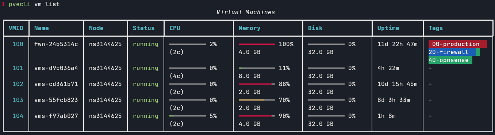

<div align="center">



**A modern, interactive CLI for managing Proxmox VE clusters**

[](https://www.python.org)
[](LICENSE.txt)
[](https://github.com/Helphyy/pvecli/releases)
[](https://www.proxmox.com)
[](https://pipx.pypa.io)

[Installation](#installation) · [Quick Start](#quick-start) · [Configuration](docs/configuration.md) · [Commands](docs/commands.md)

</div>

---

## Features

- 🎛 **Interactive menus** - Arrow-key navigation for VMs, containers, nodes, tags and storage
- 🎯 **Multi-target** - `pvecli vm stop 100,101,102` or ranges `pvecli vm stop 100-105`
- 🌐 **Multi-cluster** - Switch between homelab and production with `--profile`
- 🖥 **Remote access** - Built-in VNC, SSH (with jump host), and RDP launchers
- ⚙️ **Remote exec** - Run commands on VMs via QEMU Guest Agent with shell support
- 🔌 **Node & cluster power** - Shutdown/reboot nodes or entire clusters with safe orchestration
- 🧭 **Cluster lifecycle** - Preflight checks, health with failure tolerance, create and join
- 🚚 **Migration & bulk actions** - Migrate VMs and containers, evacuate a node, start/stop/suspend/migrate guests by tag, pool or node
- 🛡 **HA rules** - Pin guests with PVE 9 HA rules (groups still supported on older clusters), arm/disarm HA for maintenance
- 🌐 **Several clusters at once** - `-p 'client-*'`, `-p @prod`: read commands, find, audit and power actions across your whole fleet
- 🔎 **find** - Who has this IP, MAC, disk or name, on which cluster, and who can access it
- 🩺 **audit** - Certificates, access, firewall, backups, old snapshots, orphan disks, in one read-only report
- ☁️ **Deploy** - A configured VM or container in one command, or a whole set of VMs and containers from a YAML file, across clusters
- 💾 **backup** - Coverage and age of every guest's backups across clusters, run, restore, prune, jobs, browse PBS backups
- 🕸 **SDN** - Zones, vnets, subnets and DHCP, with a per-profile write lock
- 🐙 **Ceph** - Health, OSDs, pools, flags and versions across your whole fleet
- 📊 **Usage reporting** - Aggregate CPU, memory and provisioned disk per cluster or per pool
- 🎨 **Rich output** - Tables, spinners, colors, and confirmation prompts
- ⚡ **Async** - Fast parallel API calls via httpx

---

## Installation

Requires **Python 3.10+** and [pipx](https://pipx.pypa.io/).

```bash
pipx install git+https://github.com/Helphyy/pvecli.git
```

To upgrade:

```bash
pipx upgrade pvecli
```

---

## Quick Start

**1.** Create an API token in Proxmox: **Datacenter → Permissions → API Tokens → Add**

**2.** Configure pvecli:

```bash
pvecli config add
```

The interactive wizard asks for host, port, user, token name, and token value.

**3.** Test the connection:

```bash
pvecli config test
```

**4.** Start using it:

```bash
pvecli node list
pvecli vm list
pvecli ct list
```

> Every command works **interactively** when called without arguments - just navigate the menu with arrow keys.

---

## Command Groups

| Group | Description |
|:------|:------------|
| `pvecli config` | Manage cluster profiles (add, edit, remove, test, default, login) |
| `pvecli node` | Node info, shutdown, reboot, evacuate, maintenance, updates, VNC shell, SSH |
| `pvecli vm` | Full VM lifecycle - start, stop, deploy, cloud-init, clone, migrate, template, snapshot, HA, exec, VNC, SSH, RDP |
| `pvecli ct` | LXC container lifecycle - start, stop, deploy, clone, migrate, template, snapshot, HA, VNC, SSH |
| `pvecli storage` | Add and remove shared storage, listing, content management, config |
| `pvecli pool` | Resource pool management with usage reporting and export/import |
| `pvecli cluster` | Preflight, health, create, join, bulk guest actions, HA arm/disarm, status, usage, tasks, shutdown, reboot |
| `pvecli sdn` | SDN zones, vnets, subnets and DHCP (writes locked behind `sdn_write`) |
| `pvecli ceph` | Ceph health, OSDs, pools, flags, versions and log (read only) |
| `pvecli tag` | Global tag management with color palette and export/import |
| `pvecli find` | Find guests, IPs, MACs, disks and access across clusters |
| `pvecli audit` | Read-only health and hygiene report |
| `pvecli snapshot` | Snapshots across many guests: add, list, prune |
| `pvecli deploy` | Create VMs and containers from a YAML file: validated first, planned, idempotent, parallel |
| `pvecli backup` | Backups: list, coverage, run, restore, prune, jobs, PBS file browsing |

→ **[Full command reference](docs/commands.md)**

Sizes are displayed in **base 1000** (KB, MB, GB, TB), the same units as the Proxmox web interface, so a value shown by pvecli always matches the one shown by the GUI. Reporting commands (`cluster usage`, `pool usage`, `cluster resources`, `pool list`, `pool info`, `node list`, `storage list`) accept `--json` for raw, machine-readable byte values.

---

## Examples

```bash
# Graceful shutdown with a 2-minute timeout (single, list, or range)
pvecli vm shutdown 100-105 --timeout 120

# Execute a command on multiple VMs via QEMU Guest Agent
pvecli vm exec 100-103 -- apt update && apt upgrade -y

# Execute with shell override
pvecli vm exec 106 -s powershell -- Get-Service

# Snapshot before maintenance
pvecli vm snapshot add 100 pre-update --description "Before system update"

# SSH into a VM using the Proxmox node as a jump host
pvecli vm ssh 100 --jump

# Run a one-off command against the production cluster
pvecli vm list --profile production

# Tag containers for organization
pvecli ct tag add 200 web,production

# Reboot a single node
pvecli node reboot pve1

# Shutdown the entire cluster (with HA + Ceph handling)
pvecli cluster shutdown

# Cluster-wide usage: node load, guest workload, overhead, pools, storage
pvecli cluster usage

# Aggregated usage of one pool, as JSON for a script
pvecli pool usage PROD --json

# Export/import tags and pools between clusters
pvecli tag export -o tags.json
pvecli tag import tags.json --profile production

# Check what would break a join or a maintenance window
pvecli cluster preflight

# How many nodes can this cluster still lose?
pvecli cluster health

# Add a shared NFS storage, verified on every node
pvecli storage add nfs-iso --type nfs --server 10.0.0.9 --export /srv/iso --content iso

# SDN: what is deployed, and what is waiting to be applied
pvecli sdn list
pvecli sdn health

# Ceph health across the fleet
pvecli ceph status --profile production

# Empty a node before maintenance, then shut down every guest tagged "lab"
pvecli node evacuate pve1 pve2
pvecli cluster guests shutdown --tag lab --timeout 120 --force-stop

# Who has this IP, on any of your clusters?
pvecli find 10.20.3.14 -p '*'

# Morning check across every client
pvecli audit -p 'client-*' --problems

# A ready VM from a cloud-init template
pvecli vm deploy 9000 web01 --ip dhcp --ssh-key ~/.ssh/id_ed25519.pub --wait-ip 120

# Run a command on every Debian VM, snapshot before an upgrade
pvecli vm exec --tag debian -- apt update
pvecli snapshot add pre-upgrade --tag debian
```

---

## Shell Completion

```bash
pvecli --install-completion bash && source ~/.bashrc   # Bash
pvecli --install-completion zsh  && source ~/.zshrc    # Zsh
pvecli --install-completion fish                       # Fish
```

---

## Development

```bash
git clone https://github.com/Helphyy/pvecli.git
cd pvecli
python -m venv .venv && source .venv/bin/activate
pip install -e ".[dev]"
```

```bash
ruff check src tests   # Lint
mypy src               # Type check
pytest                 # Static, unit and functional tests, no network
PVECLI_LAB=1 PVECLI_LAB_PROFILES=lab1 pytest -m lab   # Read-only, against a lab
```

The functional tests run the real CLI against a fake Proxmox API fed with responses recorded on real clusters. How to write a test, record fixtures and work test first: [tests/README.md](tests/README.md). The CI runs all of it on Python 3.10 to 3.14 on every push.

---

## Security

- Config stored at `~/.config/pvecli/config.yaml` with `600` permissions (owner-read only)
- API token auth recommended over password auth
- SSL verification enabled by default - use `verify_ssl: false` only for self-signed certificates

---

## License

GPLv3 - see [LICENSE.txt](LICENSE.txt)
