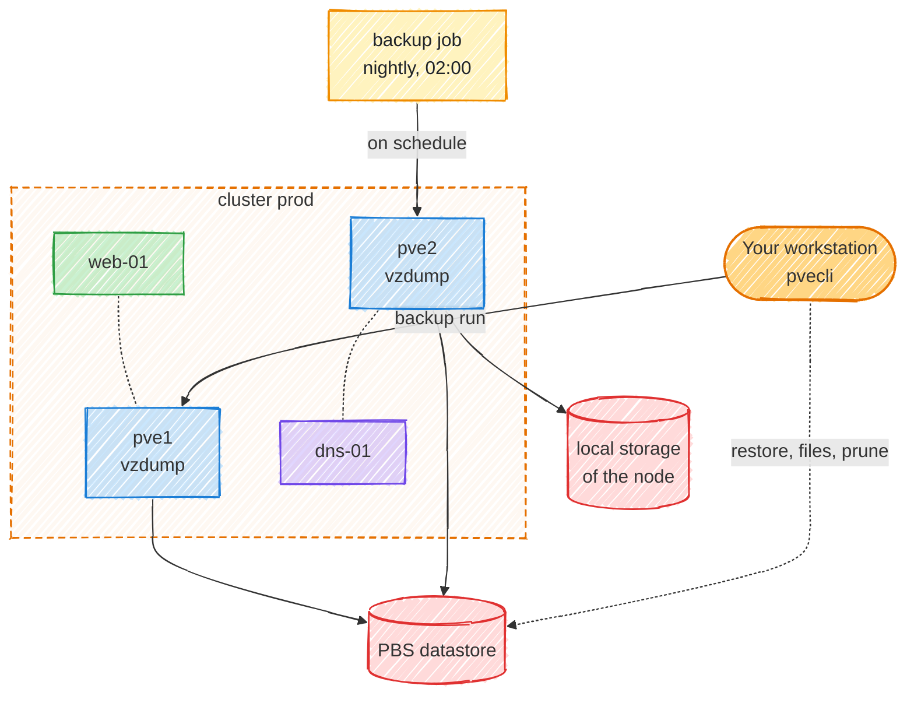

# Backups

pvecli works with the vzdump backups of your guests, wherever they are stored: a directory or NFS storage of the cluster, or a Proxmox Backup Server (PBS) datastore added as a storage. It finds them on every enabled storage that holds backups, reads a shared storage once and a local one on each node. The commands that back up, restore or delete show what they touch and ask first (`-y` skips the question).

A backup is made by vzdump on the node of the guest, started by you (`backup run`) or by a scheduled job, and written to a backup storage. A job can prune the older backups after each run; `backup prune` does it on demand.

-   :lucide-shield-check:{ .lg } __Check backup coverage__

    ---

    The guests without a job, without a recent backup or whose last run failed.

    [:lucide-arrow-right: Check backup coverage](coverage.md)

-   :lucide-play:{ .lg } __Back up guests now__

    ---

    One guest or many, to the storage you choose, each one checked.

    [:lucide-arrow-right: Back up guests now](run.md)

-   :lucide-archive-restore:{ .lg } __Restore a backup__

    ---

    As a new guest, or over a stopped one.

    [:lucide-arrow-right: Restore a backup](restore.md)

-   :lucide-folder-open:{ .lg } __Restore files from a PBS backup__

    ---

    Browse a PBS backup to find a file, without restoring the guest.

    [:lucide-arrow-right: Restore files from a PBS backup](restore-files.md)

-   :lucide-calendar-clock:{ .lg } __Schedule backup jobs__

    ---

    Create, change, pause, run and delete the jobs of a cluster.

    [:lucide-arrow-right: Schedule backup jobs](jobs.md)

-   :lucide-trash-2:{ .lg } __Prune and protect backups__

    ---

    Retention rules, protection, notes and removal.

    [:lucide-arrow-right: Prune and protect backups](retention.md)

[Check backup coverage](coverage.md){ .md-button .md-button--primary }
[backup commands](../cli/backup/index.md){ .md-button }
