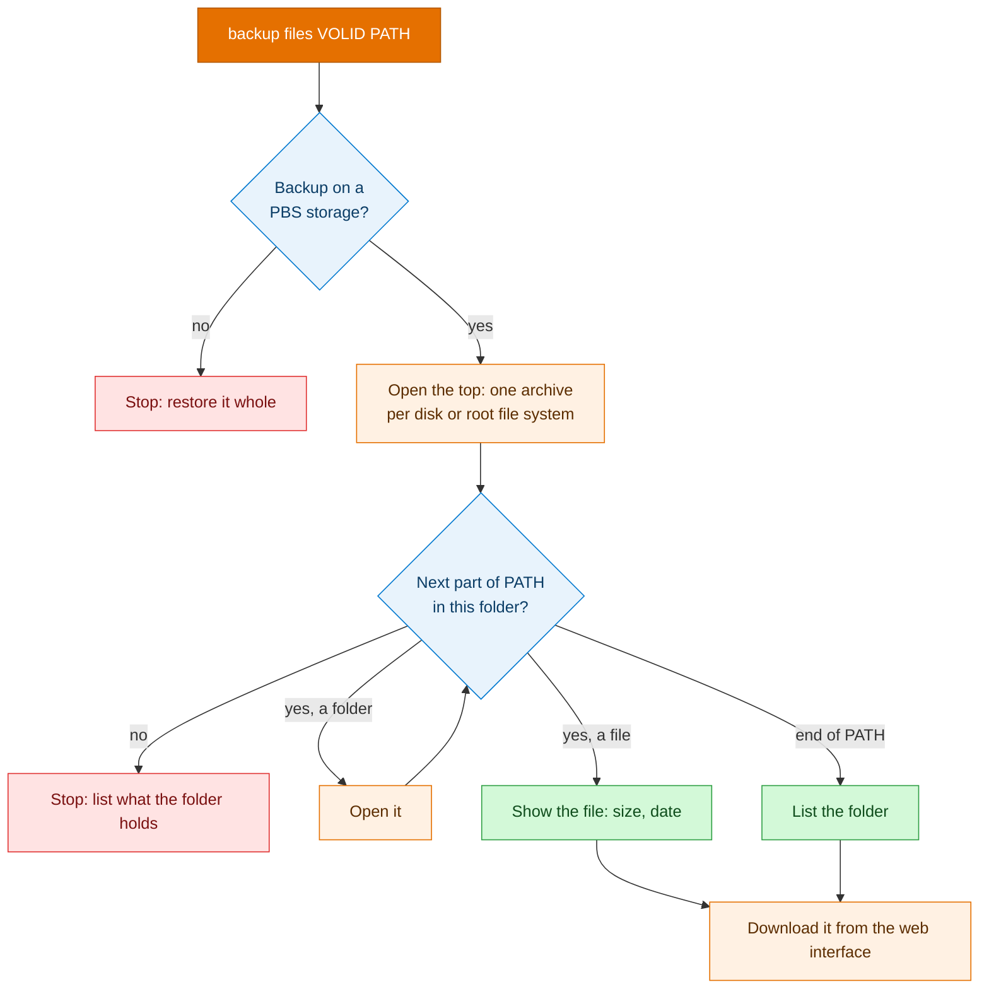

# Restore files from a PBS backup

A backup stored on a Proxmox Backup Server (PBS) can be opened file by file. [backup files](../cli/backup/files.md) lists what is inside, so you can find the file and the backup that holds the version you want before restoring anything. It only reads: nothing is restored or changed.



Start at the top of the backup:

--8<-- "screens/backups-files-root.html"

A container backup holds one archive, `root.pxar.didx`, with the file system of the container. A VM backup holds one archive per disk (`drive-scsi0.img.fidx`, `drive-virtio0.img.fidx`...).

Add the path to open, starting with the archive name:

--8<-- "screens/backups-files-dir.html"

A path that ends on a file shows that file alone, with its size and date:

--8<-- "screens/backups-files-file.html"

If a part of the path does not exist, pvecli says what the folder holds instead:

```text
Error: 'interface' not found in /root.pxar.didx/etc/network. It holds: if-down.d, if-up.d,
ifupdown2, interfaces, interfaces.d
```

With `--json`, the entries are printed as a list of `name`, `type`, `size` and `mtime` (Unix time) for scripts.

## Download the file

pvecli does not download files. Once you know the backup and the path, download the file from the Proxmox VE web interface: select the PBS storage under a node, open **Backups**, select the backup, click **File Restore** and go to the same path. A folder is downloaded as an archive.

## Only on PBS

A backup on a directory, NFS or CIFS storage is a single vzdump archive that Proxmox VE cannot open file by file. pvecli refuses it:

--8<-- "screens/backups-files-local.html"

Restore it whole as a new guest instead, with `--vmid` set to a free ID (see [Restore a backup](restore.md)), then copy the file from that guest.

!!! note "A browsed VM backup stays in use for a while"
    After you browse inside a VM disk archive, the backup stays in use on the PBS for some time (20 minutes or more). Removing it during that time fails, and pvecli says that the backup is in use on the Proxmox Backup Server. Run the removal again later.
