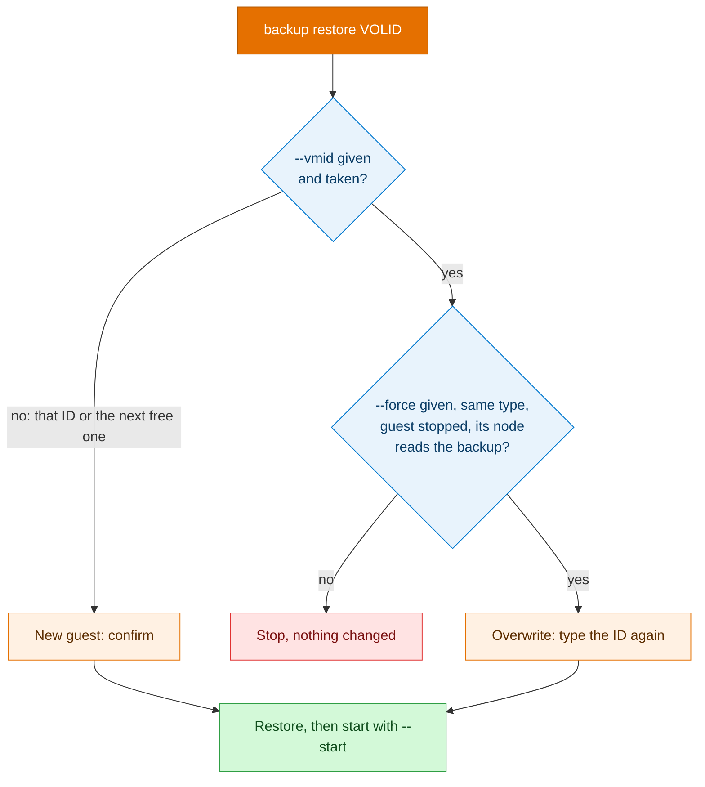

# Restore a backup

Find the volid of the backup with [backup list](../cli/backup/list.md) (see [Check backup coverage](coverage.md#list-the-backups)), then pass it to [backup restore](../cli/backup/restore.md):

```bash
pvecli backup list --vmid 822 -p prod
```

What pvecli checks before it restores anything:



`-y` skips the confirmation and the typed ID.

## As a new guest

With `--vmid`, the backup becomes a new guest with that ID; without it, pvecli takes the next free ID of the cluster. The original guest is not touched:

--8<-- "screens/backups-restore-new.html"

`--unique` gives the network cards of the new guest new random MAC addresses. Use it whenever the original guest may run at the same time as the copy, or both get the same MAC address on the network.

## Where it is restored

| Target | Default | Change it with |
|---|---|---|
| Node | For a backup on a shared storage (PBS, NFS...), the node of the original guest when it still exists and is online, else the first online node that reads the storage. For a backup on a local storage, the node that holds the file. | `--node` (a shared storage only: a local file can only be restored on its node) |
| Storage of a VM | The storages recorded in the backup, disk by disk. | `-s`, `--storage`: every disk goes there. |
| Storage of a container | The storage of its root disk, read from the backup. | `-s`, `--storage` |

pvecli reads the root disk storage of a container from the backup because Proxmox VE would otherwise put every volume of the container on `local`. Here the root disk was on the Ceph storage `ceph-vm`, and `--start` starts the container once it is restored:

--8<-- "screens/backups-restore-ct.html"

## Over an existing guest

If the ID is taken, pvecli stops before anything is changed:

--8<-- "screens/backups-restore-exists.html"

`--force` restores over the existing guest. The guest must be stopped, be of the same type as the backup (VM or container) and live on a node that can read the backup. pvecli asks you to type the ID again:

--8<-- "screens/backups-restore-force.html"

!!! danger "The current disks of the guest are destroyed"
    `--force` replaces the configuration and every disk of the guest with those of the backup. Everything written to the guest since the backup is lost. With `-y`, pvecli does not ask for the ID. If you are not sure which state you need, restore as a new guest first and compare.

