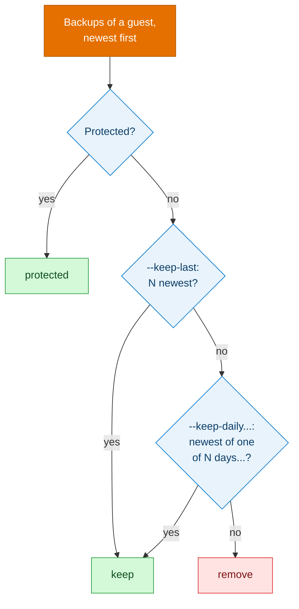

# Prune and protect backups

## Prune by retention

[backup prune](../cli/backup/prune.md) asks Proxmox VE which backups of a storage its retention rules would remove, shows that decision for each backup, and removes them only once you confirm. Start with `--dry-run` to see the decision without being asked:

--8<-- "screens/backups-prune-dry.html"

The rules are the `--keep-*` options, the same as in the Proxmox VE web interface:

| Option | Keeps |
|---|---|
| `--keep-last N` | The N newest backups. |
| `--keep-hourly N` | The newest backup of each of the last N hours that have one. |
| `--keep-daily N` | The newest backup of each of the last N days that have one. |
| `--keep-weekly N` | The newest backup of each of the last N weeks that have one. |
| `--keep-monthly N` | The newest backup of each of the last N months that have one. |
| `--keep-yearly N` | The newest backup of each of the last N years that have one. |

For each guest, the backups are taken newest first and each one gets a decision:

The rules apply to each guest separately. `--vmid` limits the prune to the backups of one guest, `--type qemu` or `--type lxc` to the VMs or the containers. Without any `--keep-*` option, the retention configured on the storage applies; if the storage has none, pvecli stops:

--8<-- "screens/backups-prune-no-retention.html"

On a local storage, each node has its own backups: pvecli asks every node and adds a Node column. A shared storage (PBS, NFS...) is read once.

!!! warning "Without --vmid, every guest of the storage is pruned"
    The rules apply to all the backups on the storage, including those of guests that no longer exist. Read the Decision column before you confirm.

## Protect a backup

A protected backup is never removed, neither by pruning nor by `pvecli backup remove`. Protect the backups you want to keep beyond the retention, for example the one taken before an upgrade, with [backup protect](../cli/backup/protect.md):

--8<-- "screens/backups-protect.html"

You can also protect a backup when you take it, with `pvecli backup run --protected` (see [Back up guests now](run.md#protect-the-backup-or-add-notes)).

The same prune with `--keep-last 1` now keeps the protected backup, marked `protected`, and removes the other one after confirmation:

--8<-- "screens/backups-prune.html"

[backup unprotect](../cli/backup/unprotect.md) removes the protection.

## Add notes

[backup notes](../cli/backup/notes.md) sets the notes of a backup, shown in the Notes column of `pvecli backup list` and in the web interface. An empty string `''` clears them.

--8<-- "screens/backups-notes.html"

## Remove backups

[backup remove](../cli/backup/remove.md) deletes the backups you name, after confirmation. It takes several volids. A protected backup is refused until you unprotect it:

--8<-- "screens/backups-remove-protected.html"

--8<-- "screens/backups-unprotect.html"

--8<-- "screens/backups-remove.html"

When the same local volid exists on several nodes, pvecli stops and asks you to pick one with `--node`.
