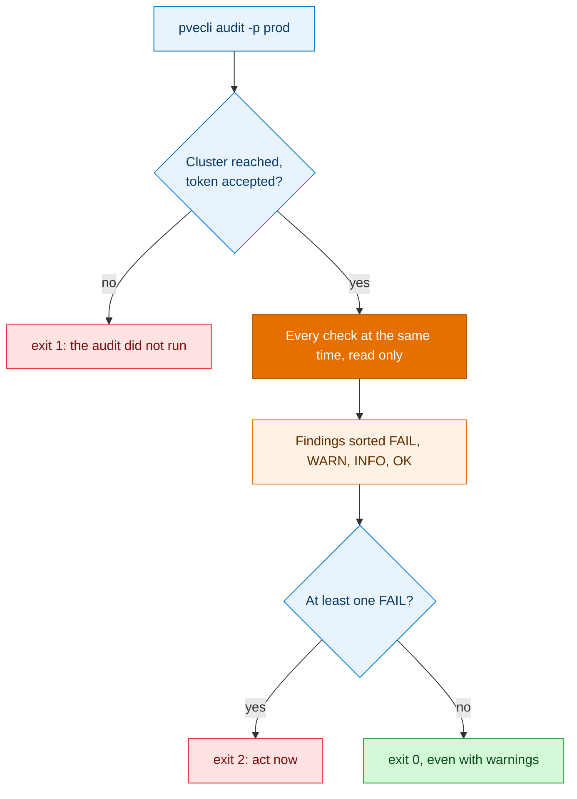

# Audit a cluster

Run [audit](../cli/audit.md) to list what needs attention on a cluster. It only reads, and changes nothing.

--8<-- "screens/fleet-audit.html"

Each line is a finding with a level, worst first:

| Level | Meaning |
|:--|:--|
| `FAIL` | act now: an expired certificate, a failed backup, Ceph in error |
| `WARN` | to fix: a guest outside every backup job, the firewall off, a forgotten snapshot |
| `INFO` | worth knowing, or a check pvecli could not run (`not checked: ...`) |
| `OK` | the check passed |

The last line counts the findings of each level.

## What it checks

| Check | Reports |
|:--|:--|
| Certificates | a node certificate that expires within 30 days (`WARN`), within 7 days or already expired (`FAIL`) |
| Users, API tokens | an expired user still enabled or an expired token (`INFO`), a token with privilege separation off (`WARN` for `root@pam`, `INFO` otherwise) |
| ACL | the `Administrator` role granted on `/`, `/vms`, `/nodes` or `/storage` |
| Firewall | the datacenter firewall disabled |
| PVE versions | nodes on different Proxmox VE versions |
| Subscription | expired or invalid subscriptions (`WARN`), nodes without one (`INFO`) |
| Updates | packages pending on each node, as of the last `apt update` the node ran (pvecli does not refresh it) |
| Backups | guests in no backup job |
| Backup freshness | guests of an enabled backup job whose last backup run failed (`FAIL`), or with no backup within 2 days (`WARN`) |
| Snapshots | snapshots older than 30 days |
| Mounted ISOs | guests with an image in a CD drive |
| Orphan disks | guest volumes on a storage whose guest no longer exists |
| HA | the HA stack disarmed |
| Ceph | Ceph health: `HEALTH_WARN` is `WARN`, anything worse is `FAIL` |
| Ceph flags | flags still set, such as `noout` after a maintenance |

To act on a finding: [Check backup coverage](../backups/coverage.md) for guests outside a backup job, `pvecli find --old-snapshots 30d` ([Find a guest, an address or a disk](find.md#filters)) for the old snapshots, [Shut down or reboot a cluster](../infrastructure/cluster-power.md) for the HA stack and the Ceph flags.

## Thresholds

| Option | Default | Changes |
|:--|:--|:--|
| `--cert-days` | `30` | when a certificate starts to be reported |
| `--snapshot-age` | `30d` | the age of an old snapshot (`12h`, `30d`, `2w`) |
| `--backup-age` | `2d` | the age of a missing backup, for guests in a backup job |
| `--skip-orphans` | | skips the orphan disk scan, which lists the content of every storage |

```bash
pvecli audit -p prod --backup-age 8d --snapshot-age 2w
```

A weekly backup job needs `--backup-age 8d`, or every guest of the job is reported once its backup is more than two days old.

## Only the problems, on every cluster

`--problems` hides the `INFO` and `OK` lines. The count line still counts every finding.

--8<-- "screens/fleet-audit-problems.html"

## Exit code



`--problems` does not change the code: it only hides lines.

A wrong option or argument also exits `2`, as for every command ([Exit codes](../reference/exit-codes.md)): try a new command line by hand before you put it in a script.

With several profiles, the command exits `2` when every failed profile found a `FAIL`, and `1` as soon as one profile could not run. To know which cluster is in which case, run one profile per call: see [Use pvecli in scripts](scripting.md).

## When a check says "not checked"

pvecli never reports `OK` for something it could not read. When the API token lacks a privilege, the check becomes an `INFO` line that starts with `not checked:` and names what could not be read and the missing privilege. Give the token the role described in [Permissions](../reference/permissions.md) to run every check.
