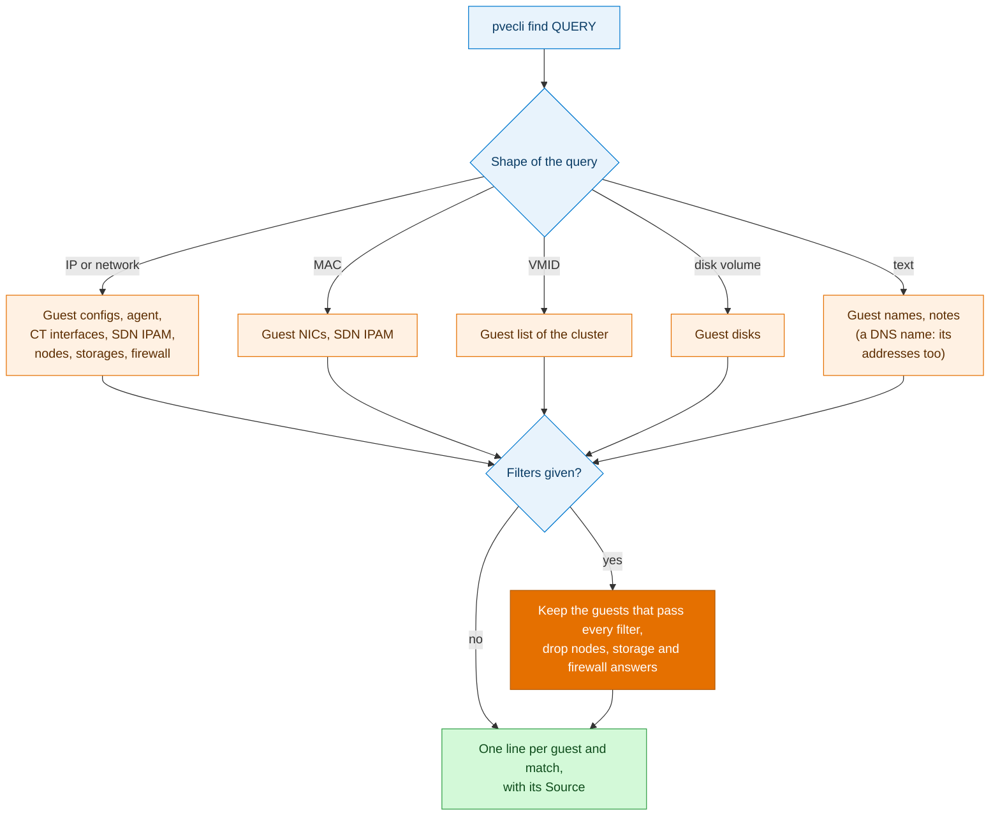

# Find a guest, an address or a disk

Give [find](../cli/find.md) what you have: an IP, a network, a MAC, a VMID, a disk volume, a DNS name or a piece of text. pvecli tells which from its shape. Add `-p '*'` when you do not know the cluster.

--8<-- "screens/fleet-find-ip.html"

- `net0 10.0.0.86/24`, source `config`: the address set in the container's configuration.
- `10.0.0.86 on eth0 (BC:24:11:BE:EC:79)`, source `lxc`: the address the container has now, read from its interfaces, with the interface and its MAC.

The Source column tells where each answer comes from:

| Source | Where pvecli read it |
|:--|:--|
| `config` | the guest configuration: `net0` of a container, `ipconfig0` (cloud-init) of a VM, disks |
| `agent` | the QEMU guest agent of a running VM that has the agent enabled |
| `lxc` | the interfaces of a running container |
| `IPAM <name>` | an SDN IPAM |
| `cluster` | the cluster: node addresses, guest names and IDs |
| `storage` | the server, portal or monitor addresses of a storage |
| `firewall` | the datacenter firewall aliases and IP sets |

A stopped guest is found by its configured address only: pvecli reads live addresses from running guests.

The shape of the query decides which sources pvecli reads:



## A network

A network finds every guest address in it, and the nodes, storage servers and firewall entries too.

--8<-- "screens/fleet-find-network.html"

## A MAC

```bash
pvecli find bc:24:11:be:ec:79 -p '*'
```

Case does not matter, and `-` works as a separator. pvecli compares it with the NICs of every guest configuration and with the SDN IPAM entries.

## A disk volume

Give the volume with or without its storage (`local-lvm:vm-861-disk-0` or `vm-861-disk-0`). The answer names the guest and the disk that uses it.

--8<-- "screens/fleet-find-volume.html"

When no guest uses the volume, pvecli says so. If the volume is still on a storage, it is an orphan: [audit](audit.md) lists them all.

--8<-- "screens/fleet-find-orphan.html"

## A name, a hostname or notes

Text is matched, case-insensitive, against guest names and guest notes.

--8<-- "screens/fleet-find-text.html"

A DNS name that resolves (`proxy-02.example.com`) is searched as the addresses it resolves to, and as text.

## What happened to a guest

`--tasks` adds the last three tasks run on each guest found: when, what, by whom, and the result.

--8<-- "screens/fleet-find-tasks.html"

Tasks are matched by VMID: the tasks of a removed guest that had the same ID show too.

## Filters

Filters narrow a search, or replace it: without a query, they apply to every guest of the cluster.

--8<-- "screens/fleet-find-filters.html"

| Filter | Keeps the guests |
|:--|:--|
| `--on-storage local-lvm` | with a disk on this storage |
| `--stopped`, `--running` | in this state |
| `--no-backup` | in no backup job |
| `--old-snapshots 30d` | with a snapshot older than this (`12h`, `30d`, `2w`) |
| `--on-bridge vmbr0`, `--on-vnet vnet1`, `--vlan 20` | with a NIC on this bridge, vnet or VLAN tag |
| `--iso debian` | with an ISO image whose name contains this text in a CD drive |
| `--tag web`, `--pool clients`, `--rule ha-web` | with this tag, in this pool, in this HA rule |
| `--no-agent` | VMs without the guest agent enabled |
| `--min-ram 8G`, `--min-cores 4`, `--os windows` | with at least this much memory, at least this many vCPUs, this OS type |

Filters combine with each other and with a query. With a filter, infrastructure answers (nodes, storage, firewall) are left out:

```bash
pvecli find 10.0.0.0/24 --running -p prod
pvecli find --no-backup --stopped -p '*'
```

The full list is in the [find](../cli/find.md) reference.

## Who has access to a guest

`--access` lists the ACL entries that reach a guest: on the guest itself, on `/vms`, on `/`, and on its pool. `--user` lists the entries held by a user or an API token.

```bash
pvecli find --access 860 -p prod
pvecli find --user alice@pve -p prod
pvecli find --user 'automation@pve!backup' -p prod
```

The answer is a table of ACL entries (who, user, group or token, role, path, propagated or not), or `No ACL entry found`. Access that does not come from an ACL entry, such as that of `root@pam`, is not in the table.

## When nothing is found

pvecli prints `Nothing found` and exits 0. An API token without the privileges to read every guest sees only part of the cluster: pvecli then prints `Warning: not searched:` and what it could not read. The privileges `find` needs are in [Permissions](../reference/permissions.md).
