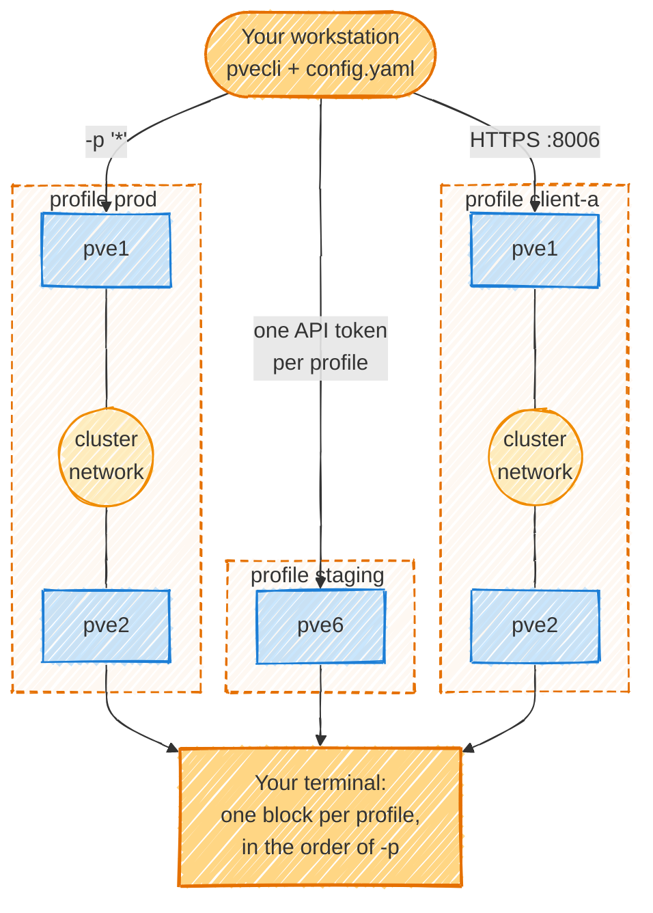

# Fleet

This section is for people who look after more than one cluster: one cluster per client, or prod and staging side by side. Each cluster is a profile, and `-p` takes a list of profiles, a pattern or a group: the command runs on each cluster and prints one block per profile. `find` and `audit` are as useful on a single cluster. The last page covers running pvecli unattended, from cron or CI.

-   :lucide-layers-2:{ .lg } __Run a command on several clusters__

    ---

    Lists, patterns and groups of profiles, failures, order and JSON.

    [:lucide-arrow-right: Several clusters](several-clusters.md)

-   :lucide-search:{ .lg } __Find a guest, an address or a disk__

    ---

    Which guest, node or storage owns an IP, a MAC, a volume or a name.

    [:lucide-arrow-right: Find](find.md)

-   :lucide-clipboard-check:{ .lg } __Audit a cluster__

    ---

    Certificates, access, firewall, backups, snapshots and orphan disks.

    [:lucide-arrow-right: Audit](audit.md)

-   :lucide-code:{ .lg } __Use pvecli in scripts__

    ---

    `--json`, `-y`, exit codes, cron and CI.

    [:lucide-arrow-right: Scripting](scripting.md)

[Run a command on several clusters](several-clusters.md){ .md-button .md-button--primary }

Reference: [exit codes](../reference/exit-codes.md), [find](../cli/find.md), [audit](../cli/audit.md).
