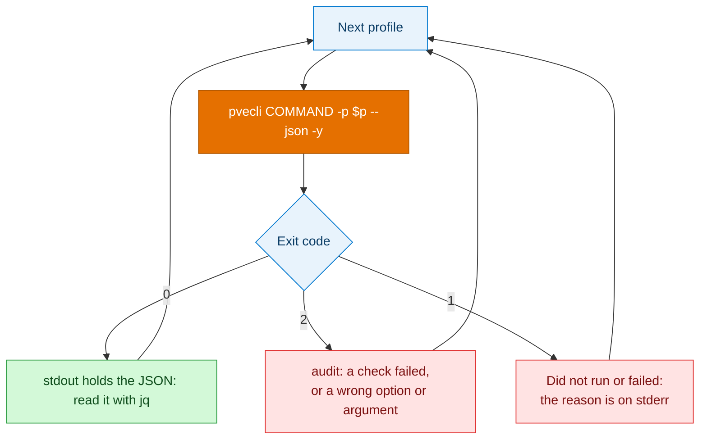

# Use pvecli in scripts

From cron or CI, name the cluster with `-p` on every call, add `--json` when the script reads the output, and `-y` when the command asks for a confirmation. Then test the exit code.

## Read JSON

The commands listed below take `--json`. The document goes to stdout, with sorted keys and no colors; errors go to stderr.

--8<-- "screens/fleet-audit-json.html"

Pipe it to `jq`. Here with [audit](../cli/audit.md) and [backup status](../cli/backup/status.md):

```bash
# Problems found by the audit, one per line
pvecli audit -p prod --json | jq -r '.findings[] | select(.level == "FAIL" or .level == "WARN") | "\(.level) \(.check): \(.detail)"'

# Every guest in no backup job
pvecli backup status -p prod --json | jq -r '.[] | select(.jobs == []) | "\(.vmid) \(.name)"'
```

Times are Unix timestamps (seconds), as Proxmox VE returns them. Here with [snapshot list](../cli/snapshot/list.md):

--8<-- "screens/fleet-snapshot-json.html"

```bash
pvecli snapshot list -p staging --json | jq -r '.[] | "\(.vmid) \(.snapshot) \(.snaptime | todate)"'
```

On several profiles, the documents are gathered under the profile names, and a profile that failed holds `error` and `exit_code` instead (see [Run a command on several clusters](several-clusters.md#output-and-order)). `arrays` skips the failed ones:

```bash
pvecli backup status -p '*' --json | jq -r 'to_entries[] | .key as $p | .value | arrays | .[] | select(.jobs == []) | "\($p) \(.vmid) \(.name)"'
```

These commands take `--json`:

| Group | Commands |
|:--|:--|
| | `find`, `audit` |
| `node` | `list`, `updates` |
| `cluster` | `preflight`, `health`, `resources`, `usage` |
| `storage` | `list` |
| `pool` | `list`, `usage`, `info` |
| `ceph` | `status`, `osd`, `pool`, `flags`, `versions` |
| `sdn` | `list`, `zones`, `info`, `health` |
| `snapshot` | `list` |
| `backup` | `list`, `status`, `files`, `jobs list` |

`vm list` and `ct list` have no `--json`. Use [cluster resources](../cli/cluster/resources.md) instead (`pvecli cluster resources -p prod --json`), or [find](../cli/find.md) with filters (`pvecli find --running -p prod --json`).

## Do not wait for an answer

Commands that stop, remove or overwrite something ask for a confirmation. `-y` answers yes, here for [vm shutdown](../cli/vm/shutdown.md):

```bash
pvecli vm shutdown 300,301 -p prod -y
```

Without `-y` and with nothing to read on standard input, pvecli cancels and exits 1:

```text
$ pvecli vm stop 861 -p staging < /dev/null
Hard stop VM 861? [y/n] (n):
Aborted.
```

Give every ID and name on the command line. pvecli opens a selection menu only when one is missing; with no terminal, it stops instead of waiting:

```text
$ pvecli ct image list -p prod < /dev/null
Node:
Error: No terminal available for the interactive menu: pass the value as an argument or an option
```

## Name the cluster

Always pass `-p`. Without it, pvecli uses the default profile of the user that runs the script, which anyone can change with [config default](../cli/config/default.md).

pvecli reads `~/.config/pvecli/config.yaml` of that user, and decrypts the secrets in it with `~/.config/pvecli/.age-identity`, next to it. A cron job runs as the user that holds both files. On a CI runner, write the file from a secret before the first call: pvecli encrypts a plain `token_value` on first read.

```bash
mkdir -p ~/.config/pvecli
cat > ~/.config/pvecli/config.yaml <<EOF
profiles:
  prod:
    host: 10.0.0.11
    verify_ssl: true
    auth:
      type: token
      user: audit@pve
      token_name: ci
      token_value: ${PVE_TOKEN}
EOF
chmod 600 ~/.config/pvecli/config.yaml
```

[config add](../cli/config/add.md) asks questions and a confirmation, so it does not fit here. The fields are in [Configuration file](../reference/config-file.md), the privileges the token needs in [Permissions](../reference/permissions.md).

## Act on the exit code

pvecli exits 0 on success and 1 on an error. `audit` exits 2 when a check fails, so a script can tell "act now" from "the audit did not run". A wrong option or argument also exits 2: run the command line by hand once. The full list is in [Exit codes](../reference/exit-codes.md).

On several profiles, any profile that does not end with 0 makes the command exit 1, including an audit that ends with 2. Loop over the profiles to keep the code of each one:



## Example: a daily audit by mail

```bash title="/usr/local/bin/pvecli-audit"
#!/bin/sh
PATH="$HOME/.local/bin:$PATH"
for p in prod staging; do
    out=$(pvecli audit -p "$p" --problems 2>&1)
    case $? in
        0) ;;
        2) printf '%s\n' "$out" | mail -s "audit $p: FAIL" ops@example.com ;;
        *) printf '%s\n' "$out" | mail -s "audit $p: did not run" ops@example.com ;;
    esac
done
```

```text title="/etc/cron.d/pvecli-audit"
30 6 * * * ops /usr/local/bin/pvecli-audit
```

pipx installs pvecli in `~/.local/bin`, which is not in the `PATH` of cron: the script adds it.

## Example: a CI check

The job fails when the audit finds a `FAIL` (exit 2) or cannot run (exit 1), and passes on warnings:

```yaml title=".gitlab-ci.yml"
audit:
  image: python:3.12
  script:
    - pip install git+https://github.com/Helphyy/pvecli.git
    - mkdir -p ~/.config/pvecli && printf '%s\n' "$PVECLI_CONFIG" > ~/.config/pvecli/config.yaml
    - pvecli audit -p prod --problems
```

`PVECLI_CONFIG` is a CI variable that holds a configuration file like the one above. Other ways to install pvecli are in [Install pvecli](../start/install.md).
