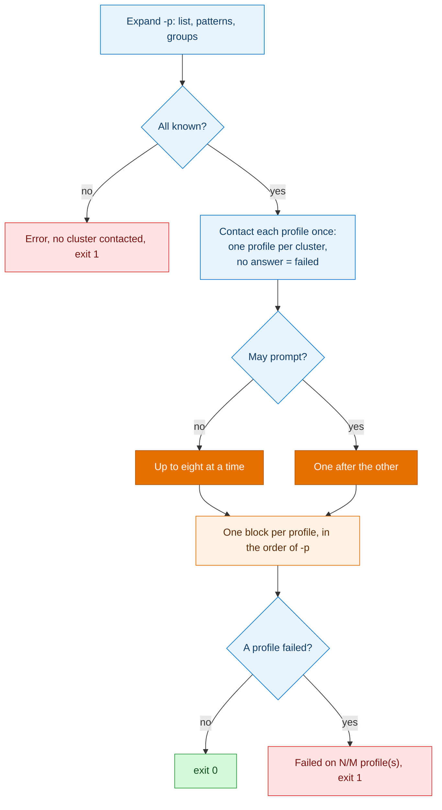

# Run a command on several clusters

Each cluster you manage is a profile in pvecli's configuration (add them with [config add](../cli/config/add.md), see [Connect to a cluster](../start/connect.md)). Give `-p` several profiles separated by commas: the command runs once per profile, under a header with the profile name. Here [vm list](../cli/vm/list.md):

--8<-- "screens/fleet-vm-list.html"

## Ways to name profiles

| `-p` value | Profiles reached |
|:--|:--|
| `prod` | the profile `prod` |
| `prod,staging` | `prod`, then `staging` |
| `'*'` | every profile |
| `'client-*'` | every profile whose name matches the pattern (`*`, `?` and `[...]`, as in the shell) |
| `@prod` | the profiles of the group `prod` |
| `@prod,staging` | a mix of the above, separated by commas |

Quote patterns, or the shell expands them against the files of the current folder. A profile reached twice runs once. An unknown profile or group, or a pattern that matches nothing, stops the command before it contacts any cluster. With a pattern, [node list](../cli/node/list.md) on every cluster:

--8<-- "screens/fleet-node-list-all.html"

## Groups

A group is a named list of profiles, in the `groups` section of `~/.config/pvecli/config.yaml`. No command edits it: open the file and add the section.

```yaml
groups:
  prod: [prod, client-a, client-b]
  test: [staging, client-a-test]
```

`pvecli cluster health -p @prod` ([cluster health](../cli/cluster/health.md)) then runs on `prod`, `client-a` and `client-b`, in that order. The fields of the file are described in [Configuration file](../reference/config-file.md).

## Keep a profile out of patterns and groups

Set `fleet: false` on a profile you only want to reach by name:

```yaml
profiles:
  prod:
    host: 10.0.0.11
    fleet: false
    # (auth and the other fields unchanged)
```

`-p '*'`, `-p 'p*'` and `-p @prod` now skip `prod`; `-p prod` and `-p prod,staging` still reach it. A group whose members are all `fleet: false` is refused with an error that says so.

## When a profile fails

A profile that fails does not stop the others. pvecli prints its error under its header, goes on, and ends with a summary line on stderr. Here [snapshot list](../cli/snapshot/list.md) for a guest that exists on one cluster only:

--8<-- "screens/fleet-failed-profile.html"

- `Error: No guest matches these filters`: guest 861 exists only on `staging`, so the command fails on `prod`.
- `Failed on 1/2 profile(s): prod`: the summary, on stderr. The command exits 1, even though `staging` succeeded.

Before running, pvecli contacts every profile once. A cluster that does not answer is reported under its header and the others run. Two profiles that point at the same cluster (two users, or two nodes of one cluster) run once, with a message on stderr:

```text
Skipping profile prod-admin: same cluster as prod
```

## Output and order



Read-only commands (lists, `health`, `find`, `audit`...) query up to eight clusters at the same time, then print the results in the order of `-p`. Commands that can ask for a confirmation (`start`, `stop`, `backup run`, `snapshot prune`...) run one profile after the other, so their prompts never mix.

With `--json`, the documents of all profiles are gathered into one object keyed by profile name. A profile that failed holds `error` and `exit_code` instead of its document.

--8<-- "screens/fleet-find-json-all.html"

## Commands that take several profiles

| Group | Commands |
|:--|:--|
| `vm` | `list`, `start`, `stop`, `shutdown`, `reboot`, `suspend`, `resume`, `exec`, `ha status` |
| `ct` | `list`, `start`, `stop`, `shutdown`, `reboot`, `ha status` |
| `node` | `list`, `updates` |
| `cluster` | `preflight`, `health`, `status`, `resources`, `usage`, `tasks` |
| `storage` | `list` |
| `pool` | `list`, `usage` |
| `ceph` | `status`, `osd`, `pool`, `flags`, `versions`, `log` |
| `sdn` | `list`, `zones`, `health` |
| `snapshot` | `add`, `list`, `prune` |
| `backup` | `list`, `status`, `run`, `jobs list` |
| | `find`, `audit` |

The other commands take one profile only.

A VMID names a different guest on each cluster. To act on the same kind of guest everywhere, select it by tag or pool rather than by ID, here with [vm shutdown](../cli/vm/shutdown.md):

```bash
pvecli vm shutdown --tag maintenance -p '*' -y
```

A cluster where no VM carries the tag reports an error and counts as failed in the summary.
