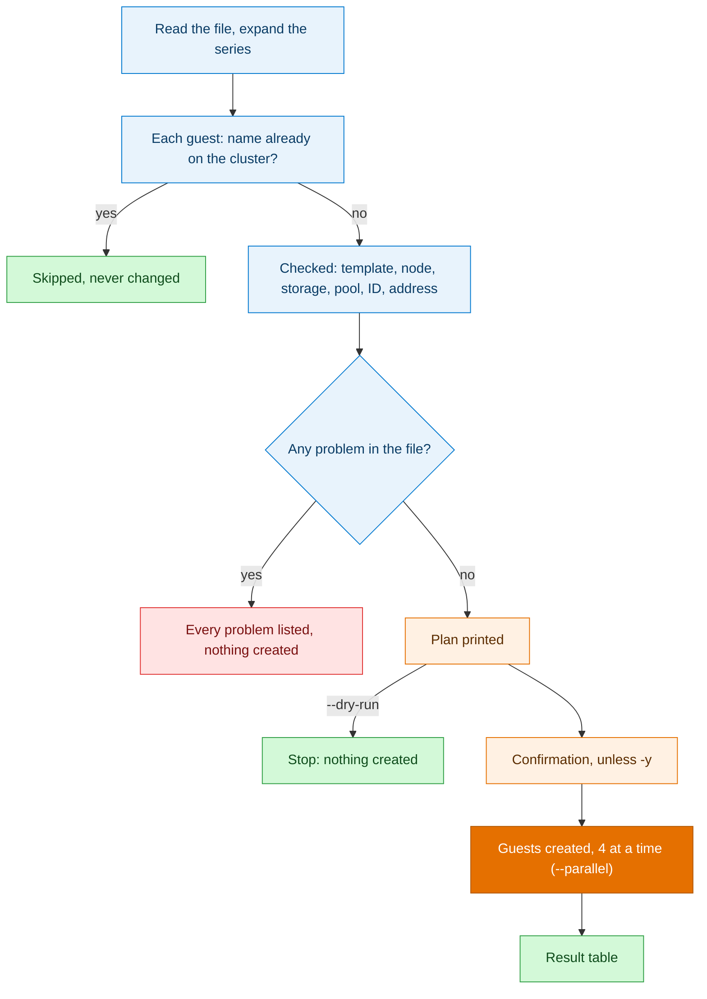

# Deploy guests from a YAML file

[deploy](../cli/deploy.md) reads a file of VMs and containers, checks all of them against the cluster, and creates those that do not exist yet. Each guest goes through the same steps as `vm deploy` or `ct deploy` (see [Create a VM](create-vm.md) and [Create a container](create-container.md)).



## Write the file

Two VMs cloned from cloud-init template 819 and one container created from an image ([guests.yaml](guests.yaml)):

```yaml
defaults:
  gw: 10.0.0.1
  ssh_key: ~/.ssh/id_ed25519.pub # (1)!
  vm: # (2)!
    template: 819
    user: debian
  ct:
    template: local:vztmpl/debian-13-standard_13.6-1_amd64.tar.zst
    node: pve1
    storage: local-lvm

guests:
  - type: vm
    name: api-{n:02} # (3)!
    count: 2
    id: 810
    ip: 10.0.0.24/24
    cores: 2
    memory: 2G
    tags: [api]

  - type: ct
    name: dns-02
    id: 812
    ip: 10.0.0.26/24
    memory: 512M
    password_env: DNS_ROOT_PASSWORD # (4)!
    tags: [dns]
```

1. A key file or the key itself; a list for several keys.
2. Defaults for one type only. They override the common defaults above.
3. A series: `count: 2` gives api-01 and api-02, with IDs 810 and 811 and addresses 10.0.0.24 and 10.0.0.25. A series that would leave its subnet is refused.
4. The name of an environment variable holding the root password. A `password:` key is refused: the file never holds a password.

Every key, its type and its default are listed in [Deploy file format](../reference/deploy-file.md).

## Check it first

`--dry-run` checks the whole file (templates, nodes, storages, pools, IDs, addresses) and prints the plan without creating anything:

--8<-- "screens/guests-deploy-dry-run.html"

When something is wrong, pvecli lists every problem with the entry it comes from (`guests[1] (dns-02): ...`) and creates nothing, dry run or not.

## Deploy

The container's root password comes from the environment variable named in the file. Set it, then run the same command without `--dry-run`:

```bash
export DNS_ROOT_PASSWORD='...'
```

pvecli shows the plan again and asks before creating. With `--wait-ip`, each guest is reported with its address once it is up:

--8<-- "screens/guests-deploy-run.html"

Up to four guests are created at the same time; `--parallel N` changes that. `-y` skips the question, for a pipeline.

## Run it again

A guest whose name already exists on the cluster is skipped, never changed. Running the file a second time creates nothing:

--8<-- "screens/guests-deploy-again.html"

Add a guest to the file and run it again: only the new one is created. Two cases stop the run before anything is created: a name held by a guest of the other type (a container named like a VM of the file), and an `id:` already taken by another guest.

## When a guest fails

The other guests go on. The Result table marks the failed one, and if its creation had started, pvecli prints the `pvecli vm remove` or `pvecli ct remove` command to clean it up: nothing is deleted automatically. The command then exits with code 1 (see [Exit codes](../reference/exit-codes.md)).

## Several clusters in one file

A guest can name its profile with `profile:`, so one file can deploy on several clusters; the plan is then grouped by cluster. `-p` takes a single profile here: it applies to the guests that name none. The ways to name profiles are in [Run a command on several clusters](../fleet/several-clusters.md).

## Install VMs from an ISO

A VM can also start from an installer ISO instead of a template: `iso` replaces `template`. pvecli creates an empty disk of `disk_size` on `storage`, puts the ISO in the CD drive, and starts the VM unless `power_on: false`. The installer then runs in the [console](console.md) ([install.yaml](install.yaml)):

```yaml
x-installer: &installer # (1)!
  iso: local:iso/debian-13.8.0-amd64-netinst.iso
  storage: local
  disk_size: 16G
  memory: 2G
  cores: 2

guests:
  - type: vm
    name: build-01
    id: 810
    <<: *installer # (2)!

  - type: vm
    name: build-02
    id: 811
    <<: *installer
    disk_size: 32G # (3)!
    power_on: false # (4)!

  - type: vm
    name: win-01
    id: 812
    iso: local:iso/windows-server-2025.iso
    virtio_iso: local:iso/virtio-win-0.1.285.iso # (5)!
    os_type: windows # (6)!
    storage: local
    disk_size: 64G
    memory: 4G
    power_on: false
```

1. A block to reuse, under a key that starts with `x-`: pvecli ignores it (see [Reuse settings with YAML anchors](#reuse-settings-with-yaml-anchors)).
2. Every key of the block, as if written here.
3. A key written after `<<` replaces the one of the block.
4. Created, not started: the plan says `not started`.
5. A second CD drive with the VirtIO drivers, for the Windows installer to see the disk and the network card.
6. `windows` gives Windows 11 and Server 2022/2025 their UEFI firmware, secure boot and TPM, on `storage`. Other Proxmox VE types (`win10`, `l26`...) are taken as they are.

The plan shows the ISO as the source, and the bridge the card goes on:

--8<-- "screens/guests-deploy-iso-dry-run.html"

--8<-- "screens/guests-deploy-iso-run.html"

The disk comes first in the boot order. On the first start it is empty, so the VM boots the ISO; once the system is installed on it, the VM boots the disk. The ISO can stay in the drive.

An ISO install has no cloud-init: the address, the user and the keys are set in the installer. A cloud-init key (`user`, `ssh_key`, `password_env`, `ip`, `gw`, `dns`...) on such a guest, or `template` and `iso` together, is refused:

```text
Error: guests[0] (inst-01): an ISO install has no cloud-init: ssh_key, ip cannot
apply
Error: guests[1] (inst-02): template and iso both given: a VM is cloned or
installed, not both
Error: 2 problem(s) in the file: nothing was created
```

A key in the common `defaults` also feeds the containers and the clones: an ISO VM leaves its cloud-init keys out, without an error. In `defaults.vm`, a cloud-init key is meant for every VM, and an ISO VM refuses it unless it clears it with `null` (`user: null`). A `template` from the defaults gives way to the `iso` of the guest, and the other way round.

!!! note "The Windows installer waits for a key"
    The Windows ISO shows `Press any key to boot from CD or DVD` for a few seconds, then gives up. Deploy it with `power_on: false`, open its console, start it and press a key:

    ```bash
    pvecli vm start 812 -p prod && pvecli vm vnc 812 -p prod
    ```

## Reuse settings with YAML anchors

`defaults` applies to every guest. For settings shared by some guests only, YAML has anchors: `&name` names a block, `*name` repeats it, and `<<: *name` merges its keys into a guest, the keys written next to it winning. pvecli ignores the top-level keys that start with `x-`, so the blocks can live there:

```yaml
x-small: &small # (1)!
  cores: 1
  memory: 1G
x-large: &large
  cores: 4
  memory: 8G
  disk_size: 80G
x-web-tags: &web-tags [web, prod] # (2)!

defaults:
  vm:
    template: 9000
    user: debian
    ssh_key: ~/.ssh/id_ed25519.pub

guests:
  - type: vm
    name: web-{n:02}
    count: 3
    ip: 10.0.0.21/24
    tags: *web-tags
    <<: *small

  - type: vm
    name: db-01
    ip: 10.0.0.30/24
    tags: [db, prod]
    <<: *large
    memory: 16G # (3)!
```

1. A block of keys. Any key a guest takes can be in it.
2. A single value or a list can be anchored too: `tags: *web-tags`.
3. Replaces the `memory` of `*large` for this guest only.

The anchors are read by the YAML parser before pvecli sees the file: a guest gets exactly the keys it would have if they were written in it, and the same checks apply. An `x-` key is only a place for anchors: its content is never a guest.

## More examples

Each file below is complete. Run it with `--dry-run` first.

=== "Cloud-init series"

    Ten web servers from template 9000, addresses from 10.0.0.101, each with its own ID from 901:

    ```yaml
    defaults:
      gw: 10.0.0.1
      dns: 10.0.0.1
      ssh_key: ~/.ssh/id_ed25519.pub
    guests:
      - type: vm
        name: web-{n:02}
        count: 10
        id: 901
        template: 9000
        user: debian
        ip: 10.0.0.101/24
        cores: 2
        memory: 2G
        tags: [web]
    ```

=== "ISO, not started"

    Three empty VMs on a VLAN, ready for their installer, none started:

    ```yaml
    x-lab: &lab
      iso: local:iso/debian-13.8.0-amd64-netinst.iso
      storage: local-lvm
      disk_size: 20G
      bridge: vmbr1
      vlan: 30
      power_on: false
    guests:
      - type: vm
        name: lab-{n}
        count: 3
        <<: *lab
    ```

=== "Clones and ISO"

    The template of `defaults.vm` feeds the clone; the ISO VM sets its own source, and the common `ssh_key` is left out for it. `user` goes on the clone: in `defaults.vm`, the ISO VM would have to clear it with `user: null`:

    ```yaml
    defaults:
      ssh_key: ~/.ssh/id_ed25519.pub
      vm:
        template: 9000
    guests:
      - type: vm
        name: app-01
        user: debian
        ip: dhcp
      - type: vm
        name: fw-01
        iso: local:iso/OPNsense-26.1-dvd-amd64.iso
        os_type: other
        storage: local-lvm
        disk_size: 20G
        bridge: vmbr1
    ```

=== "Nested Proxmox VE"

    A VM to run Proxmox VE itself: `cpu: host` passes the virtualization of the node through:

    ```yaml
    guests:
      - type: vm
        name: pve-test-{n}
        count: 3
        iso: local:iso/proxmox-ve_9.1-1.iso
        storage: local-lvm
        disk_size: 64G
        cores: 4
        memory: 8G
        cpu: host
    ```

=== "Containers"

    Containers from a file template, the shared settings in an anchor:

    ```yaml
    x-ct: &ct
      template: local:vztmpl/debian-13-standard_13.1-2_amd64.tar.zst
      node: pve1
      storage: local-lvm
      memory: 512M
      swap: 0
      password_env: CT_ROOT_PASSWORD
    guests:
      - type: ct
        name: dns-01
        ip: 10.0.0.53/24
        <<: *ct
      - type: ct
        name: proxy-01
        ip: 10.0.0.80/24
        <<: *ct
        memory: 1G
        features: {nesting: 1}
    ```

=== "Two clusters"

    The same block on two clusters, each guest naming its profile:

    ```yaml
    x-web: &web
      template: 9000
      user: debian
      ssh_key: ~/.ssh/id_ed25519.pub
      cores: 2
      memory: 2G
    guests:
      - type: vm
        name: web-prod
        profile: prod
        ip: 10.0.0.21/24
        <<: *web
      - type: vm
        name: web-staging
        profile: staging
        ip: 10.1.0.21/24
        <<: *web
    ```

Every key is listed in [Deploy file format](../reference/deploy-file.md).
