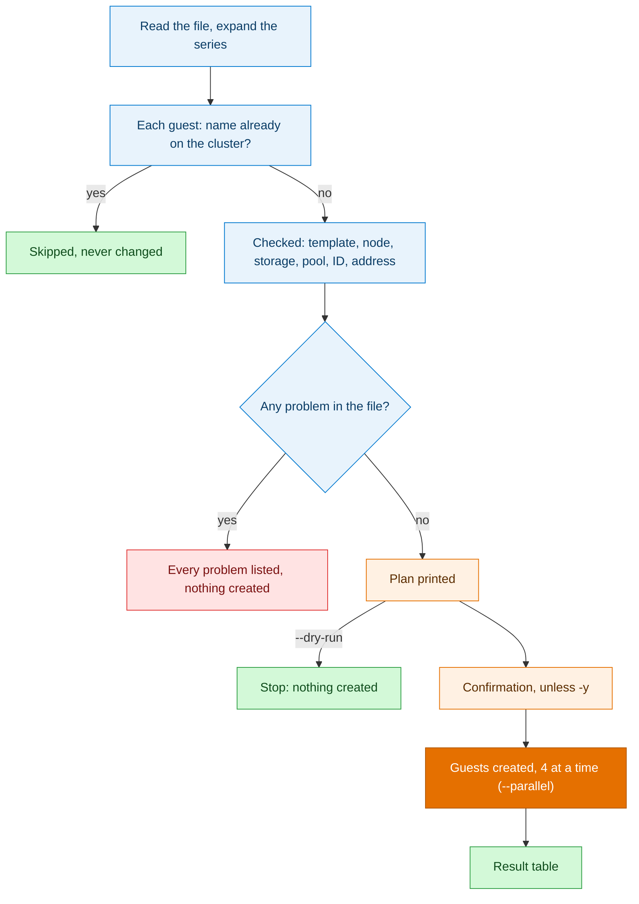

# Deploy guests from a YAML file

[deploy](../cli/deploy.md) reads a file of VMs and containers, checks all of them against the cluster, and creates those that do not exist yet. Each guest goes through the same steps as `vm deploy` or `ct deploy` (see [Create a VM](create-vm.md) and [Create a container](create-container.md)).



## Write the file

Two VMs cloned from cloud-init template 819 and one container created from an image ([guests.yaml](guests.yaml)):

```yaml
defaults:
  gw: 10.0.0.1
  ssh_key: ~/.ssh/id_ed25519.pub # (1)!
  vm: # (2)!
    template: 819
    user: debian
  ct:
    template: local:vztmpl/debian-13-standard_13.6-1_amd64.tar.zst
    node: pve1
    storage: local-lvm

guests:
  - type: vm
    name: api-{n:02} # (3)!
    count: 2
    id: 810
    ip: 10.0.0.24/24
    cores: 2
    memory: 2G
    tags: [api]

  - type: ct
    name: dns-02
    id: 812
    ip: 10.0.0.26/24
    memory: 512M
    password_env: DNS_ROOT_PASSWORD # (4)!
    tags: [dns]
```

1. A key file or the key itself; a list for several keys.
2. Defaults for one type only. They override the common defaults above.
3. A series: `count: 2` gives api-01 and api-02, with IDs 810 and 811 and addresses 10.0.0.24 and 10.0.0.25. A series that would leave its subnet is refused.
4. The name of an environment variable holding the root password. A `password:` key is refused: the file never holds a password.

Every key, its type and its default are listed in [Deploy file format](../reference/deploy-file.md).

## Check it first

`--dry-run` checks the whole file (templates, nodes, storages, pools, IDs, addresses) and prints the plan without creating anything:

--8<-- "screens/guests-deploy-dry-run.html"

When something is wrong, pvecli lists every problem with the entry it comes from (`guests[1] (dns-02): ...`) and creates nothing, dry run or not.

## Deploy

The container's root password comes from the environment variable named in the file. Set it, then run the same command without `--dry-run`:

```bash
export DNS_ROOT_PASSWORD='...'
```

pvecli shows the plan again and asks before creating. With `--wait-ip`, each guest is reported with its address once it is up:

--8<-- "screens/guests-deploy-run.html"

Up to four guests are created at the same time; `--parallel N` changes that. `-y` skips the question, for a pipeline.

## Run it again

A guest whose name already exists on the cluster is skipped, never changed. Running the file a second time creates nothing:

--8<-- "screens/guests-deploy-again.html"

Add a guest to the file and run it again: only the new one is created. Two cases stop the run before anything is created: a name held by a guest of the other type (a container named like a VM of the file), and an `id:` already taken by another guest.

## When a guest fails

The other guests go on. The Result table marks the failed one, and if its creation had started, pvecli prints the `pvecli vm remove` or `pvecli ct remove` command to clean it up: nothing is deleted automatically. The command then exits with code 1 (see [Exit codes](../reference/exit-codes.md)).

## Several clusters in one file

A guest can name its profile with `profile:`, so one file can deploy on several clusters; the plan is then grouped by cluster. `-p` takes a single profile here: it applies to the guests that name none. The ways to name profiles are in [Run a command on several clusters](../fleet/several-clusters.md).
