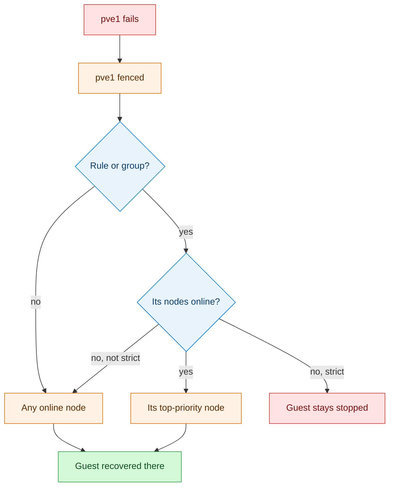

# Make a guest highly available

A guest under HA is watched by the Proxmox VE HA manager: if its node fails, the guest is started again on another node. Its disks should be on shared storage (Ceph, NFS...), where every node can reach them.

The node rule (PVE 9) or the HA group (PVE 8) holds the preferred nodes; a strict rule or a restricted group keeps the guest on them. A guest recovered on another node is started there if its HA state is `started`.

## Add a guest to HA

[vm ha add](../cli/vm/ha.md#add) with `-y` registers the VM with the defaults (state `started`) and the options you give:

--8<-- "screens/guests-vm-ha-add.html"

Without `-y`, a wizard asks for the placement, the initial state, the restart and relocate attempts and a comment. Containers take the same commands under [ct ha](../cli/ct/ha.md):

--8<-- "screens/guests-ct-ha-add.html"

The state `started` makes the HA manager start the guest if it is stopped. Use `--state stopped` to register a guest without starting it.

## Choose its nodes

=== "PVE 9"

    Placement uses HA rules. `--nodes pve2,pve3` creates a node-affinity rule named `pvecli-vm<ID>` (or `pvecli-ct<ID>`) that prefers these nodes; a priority goes after a colon (`pve2:2,pve3:1`). `--strict` restricts the guest to them: it stays stopped if none is available.

=== "PVE 8"

    Placement uses HA groups (as on a PVE 9 cluster whose groups are not migrated to rules yet). `--group NAME` puts the guest in an existing group. pvecli refuses `--nodes` on a cluster that uses groups, and `--group` on one that uses rules.

## See the HA state

[vm ha status](../cli/vm/ha.md#status) with an ID shows the configured state, the state the HA manager reports, the node and the placement:

--8<-- "screens/guests-vm-ha-status-one.html"

Without an ID, it lists every HA-managed VM:

--8<-- "screens/guests-vm-ha-status.html"

[vm ha set](../cli/vm/ha.md#set) changes the state, placement, attempts or comment of guests already under HA. `--nodes ''` drops the node rule.

## Remove a guest from HA

[vm ha remove](../cli/vm/ha.md#remove) takes the guest out of HA and, on PVE 9, out of the rules that name it (the rule pvecli created goes with it). The guest keeps running:

--8<-- "screens/guests-vm-ha-remove.html"

A guest under HA is started, stopped and migrated through the HA manager: see [Migrate a guest](migrate.md#guests-under-ha). To stop the HA stack of the whole cluster before a maintenance (arm and disarm), see [Shut down or reboot a cluster](../infrastructure/cluster-power.md).
