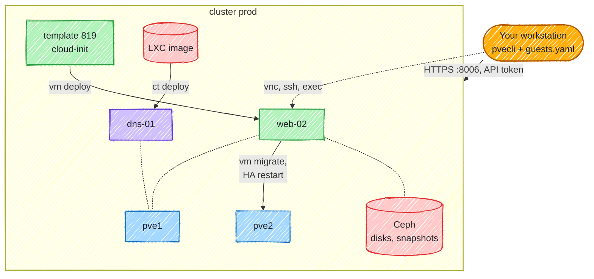

# Guests

A guest is a VM or a container. This section covers their life on the cluster: creating them one at a time or from a file, starting and stopping them, opening a console, moving them between nodes, taking snapshots, putting them under HA, and sorting them with tags and pools. The VM and container commands mirror each other: `pvecli vm start` starts a VM, `pvecli ct start` a container, and so on for each command that applies to both.

-   :lucide-monitor-cog:{ .lg } __Create a VM__

    ---

    From an ISO, from a cloud-init template in one command, or as a clone.

    [:lucide-arrow-right: Create a VM](create-vm.md)

-   :lucide-box:{ .lg } __Create a container__

    ---

    Download an LXC image, then create, start and reach a container.

    [:lucide-arrow-right: Create a container](create-container.md)

-   :lucide-file-code:{ .lg } __Deploy guests from a YAML file__

    ---

    Describe VMs and containers in a file, check it, create what is missing.

    [:lucide-arrow-right: Deploy guests from a YAML file](deploy-yaml.md)

-   :lucide-power:{ .lg } __Start, stop and reboot guests__

    ---

    One guest, a list, a range, or every guest of a tag, a pool or a node.

    [:lucide-arrow-right: Start, stop and reboot guests](power.md)

-   :lucide-terminal:{ .lg } __Open a console or a shell__

    ---

    VNC in the browser, SSH or RDP with the address found for you, commands through the agent.

    [:lucide-arrow-right: Open a console or a shell](console.md)

-   :lucide-arrow-right-left:{ .lg } __Migrate a guest__

    ---

    Move a VM live or a container with a restart, and what blocks a migration.

    [:lucide-arrow-right: Migrate a guest](migrate.md)

-   :lucide-camera:{ .lg } __Take and roll back snapshots__

    ---

    Snapshot one guest or many before a change, roll back, prune the old ones.

    [:lucide-arrow-right: Take and roll back snapshots](snapshots.md)

-   :lucide-heart-pulse:{ .lg } __Make a guest highly available__

    ---

    Restart a guest on another node when its node fails, on PVE 8 and 9.

    [:lucide-arrow-right: Make a guest highly available](ha.md)

-   :lucide-tags:{ .lg } __Organize guests with tags and pools__

    ---

    Tag and color guests, group them in pools, copy both to another cluster.

    [:lucide-arrow-right: Organize guests with tags and pools](tags-pools.md)

Command reference: [vm](../cli/vm/index.md), [ct](../cli/ct/index.md), [deploy](../cli/deploy.md), [snapshot](../cli/snapshot/index.md), [tag](../cli/tag/index.md), [pool](../cli/pool/index.md).

[Create a VM](create-vm.md){ .md-button .md-button--primary }
