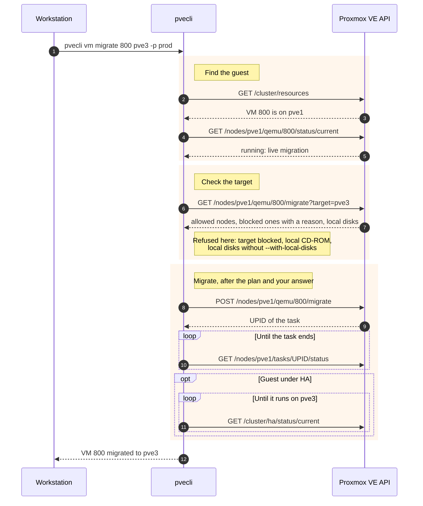

# Migrate a guest

Give [vm migrate](../cli/vm/migrate.md) the VM and the target node. A running VM moves live, without stopping:

--8<-- "screens/guests-vm-migrate.html"

Without a target, pvecli shows the other online nodes in a menu, each blocked one with its reason:

A stopped VM moves offline. `-y` skips the question.

Before it starts anything, pvecli asks Proxmox VE whether the migration is possible, and refuses with the reason when it is not: a target that is offline, or that Proxmox VE does not allow (a storage of the guest missing there, for example).

## VMs with local disks

A disk on a node's own storage (`local-lvm`, `local`, a local ZFS pool) does not exist on the target. A running VM with such a disk is refused:

--8<-- "screens/guests-vm-migrate-local.html"

`--with-local-disks` copies the disks to the target while the VM keeps running:

--8<-- "screens/guests-vm-migrate-disks.html"

The copy goes through the network and takes as long as the disk is large. The disks land on a storage of the same name on the target; `--target-storage` names another one, or a mapping `source:target`.

!!! warning
    pvecli does not check the free space on the target: look at it first with [storage list](../cli/storage/list.md). When an LVM-thin pool fills up during the copy, Proxmox VE aborts the migration and the VM stays where it was, but the guests already on that pool can stop with I/O errors.

A CD-ROM holding an ISO from a local storage blocks the migration. Eject it first (with [vm edit](../cli/vm/edit.md)), and delete the snapshots that still reference the ISO.

## Containers

A container cannot move live. A running one is stopped, moved, and started again on the target: pass `--restart`, or answer `y` when [ct migrate](../cli/ct/migrate.md) asks.

--8<-- "screens/guests-ct-migrate.html"

`-t` sets how long the container gets to shut down before it is stopped. A stopped container moves without `--restart`. A container on local storage is copied to the target like a VM disk.

## Guests under HA

A guest managed by HA is moved by the HA manager, not by the migration task: pvecli asks it to move the guest and waits until the guest runs on the target. HA itself is described in [Make a guest highly available](ha.md).

## Many guests

`pvecli cluster guests migrate pve3 --node pve2` moves every guest of pve2 to pve3 (see [Start, stop and reboot guests](power.md#many-guests-at-once)). To empty a node before maintenance, see [Put a node in maintenance](../infrastructure/node-maintenance.md).
