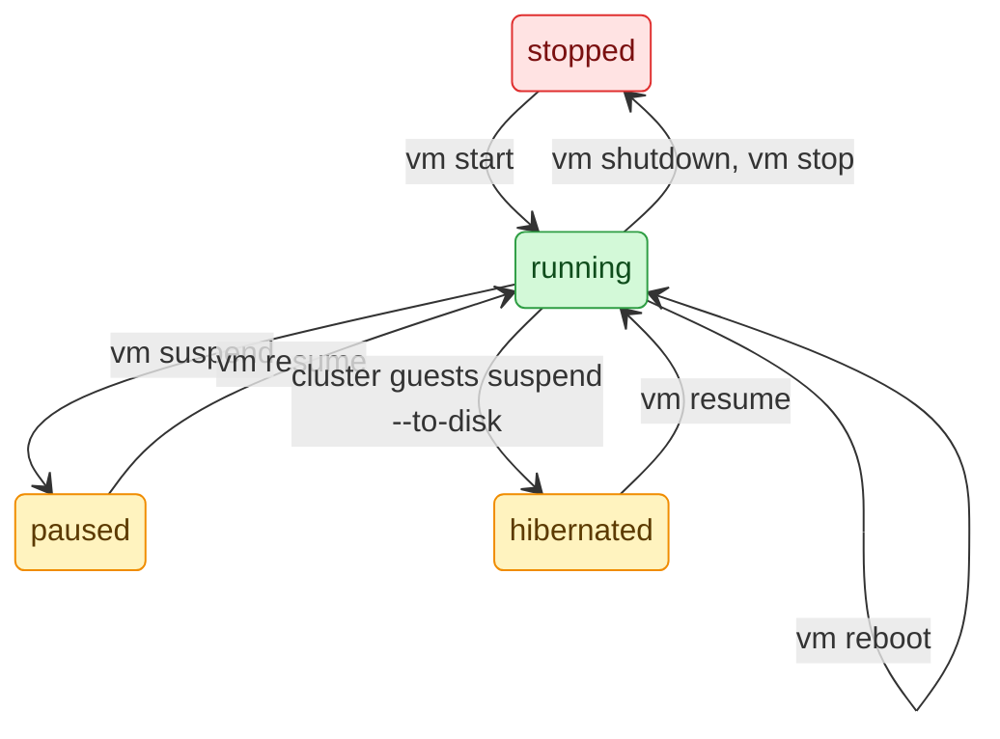

# Start, stop and reboot guests

Pass one ID, a list (`802,803`) or a range (`810-819`) to [vm start](../cli/vm/start.md):

--8<-- "screens/guests-vm-start.html"

The guests are handled one after the other. Containers take the same commands under `ct`: [ct start](../cli/ct/start.md), [ct shutdown](../cli/ct/shutdown.md), `ct stop`, `ct reboot`.

| Command | What the guest gets |
|:--|:--|
| `vm start` | Started. |
| `vm shutdown` | A shutdown request (ACPI for a VM): the OS stops its services and powers off. |
| `vm stop` | Powered off at once, like pulling the plug. Unsaved data is lost. |
| `vm reboot` | A clean reboot, through the same request as a shutdown. |
| `vm suspend` | Paused in memory: the VM keeps its RAM and stops running. VMs only. |
| `vm resume` | Running again from where it was paused. |

A hibernated VM has its RAM saved to disk and is stopped; `vm resume` brings it back where it was.

## Pick guests from a menu

Without an ID or a filter, these commands show a menu of the VMs (of the containers under `ct`). ++space++ selects, ++enter++ goes on with the selection as with IDs (a stop or a shutdown still asks first):

## Shut down or stop

Use [vm shutdown](../cli/vm/shutdown.md) in normal operation, and [vm stop](../cli/vm/stop.md) only for a guest that does not respond. Both ask first; `-y` skips the question:

--8<-- "screens/guests-vm-stop.html"

A shutdown waits for the guest to power off, 60 seconds by default (`--timeout`). A VM without an OS, or one whose OS ignores the request, is still running when the time runs out:

--8<-- "screens/guests-vm-shutdown-timeout.html"

The VM keeps running. Stop it with `vm stop`, or pass `--force` to `vm shutdown`: Proxmox VE then powers off a VM that is still running when the timeout ends.

## Pick guests by tag, pool or node

Instead of IDs, `--tag`, `--pool` and `--node` select every guest that matches (templates excluded). The selection is printed before the question:

--8<-- "screens/guests-vm-shutdown-tag.html"

The filters combine with each other and with IDs: `vm stop 810-819 --node pve1` stops only the guests of that range that run on pve1.

## Many guests at once

[cluster guests](../cli/cluster/guests.md) starts, shuts down, suspends or migrates every guest matching `--vms`, `--tag`, `--pool` or `--node`, VMs and containers together, in parallel:

--8<-- "screens/guests-cluster-guests-start.html"

=== "PVE 9"

    pvecli sends one bulk action to the cluster, which runs as a single task (`Running as one cluster task`).

=== "PVE 8"

    pvecli starts one task per node (startall, stopall, suspendall or migrateall), restricted to the selected guests (`Running as N task(s), one per node`). A suspend in memory runs as one task per VM.

When the tasks end, pvecli reads each guest again and reports those that did not reach the expected state. `--max-workers` limits how many guests are handled at the same time. `cluster guests shutdown` never hard stops a guest unless you pass `--force-stop`.

## Suspend and resume

[vm suspend](../cli/vm/suspend.md) pauses a VM in memory, [vm resume](../cli/vm/resume.md) lets it run again:

--8<-- "screens/guests-vm-suspend.html"

--8<-- "screens/guests-vm-resume.html"

A paused VM still holds its memory on the node. To free it, `cluster guests suspend --to-disk` hibernates the VMs to disk instead. pvecli suspends VMs only, not containers.
