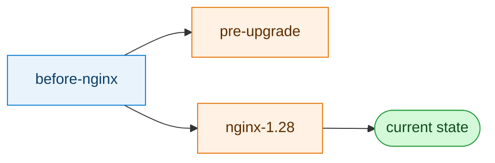

# Take and roll back snapshots

A snapshot keeps the state of a guest's disks at one moment, on the same storage, so you can go back to it. It is not a backup: it disappears with the guest or its storage (see [Back up guests now](../backups/run.md)). The guest's storage must support snapshots, as LVM-thin, ZFS, Ceph RBD and qcow2 files do.

## Snapshot one guest

[vm snapshot add](../cli/vm/snapshot.md#add) takes the VM ID and a name (a letter first, then letters, digits, `-` and `_`). `-w` waits until the snapshot is taken:

--8<-- "screens/guests-vm-snapshot-add.html"

`--vmstate` also saves the RAM of a running VM, so that a rollback brings it back running where it was. Without it, the snapshot holds the disks only.

[vm snapshot list](../cli/vm/snapshot.md#list) shows the snapshots of the VM:

--8<-- "screens/guests-vm-snapshot-list.html"

Containers take the same commands under [ct snapshot](../cli/ct/snapshot.md), without `--vmstate`.

## Roll back

[vm snapshot rollback](../cli/vm/snapshot.md#rollback) puts the disks back in the state of the snapshot. Everything written since is lost, so pvecli asks first:

--8<-- "screens/guests-vm-snapshot-rollback.html"

After a rollback to a snapshot without RAM, the VM is stopped. `--reboot` starts it again once the rollback is done (or reboots it if it is running). Without `-w` or `--reboot`, pvecli returns as soon as Proxmox VE has accepted the rollback.

The snapshots taken after the one you roll back to stay. Proxmox VE keeps them as a tree, and the next snapshot starts a new branch from the one you rolled back to. A VM on Ceph RBD, after `vm snapshot rollback 810 before-nginx` and a new snapshot `nginx-1.28`:

[vm snapshot remove](../cli/vm/snapshot.md#remove) deletes one snapshot; the guest's current state is not affected.

## The same snapshot on many guests

Before an upgrade of several guests, [snapshot add](../cli/snapshot/add.md) takes the same snapshot on each of them, VMs and containers together. Pick them with `--vms`, `--tag`, `--pool` or `--node`, or `--all`:

--8<-- "screens/guests-snapshot-add.html"

A guest that already has a snapshot of that name is skipped with a warning. Up to four snapshots are taken at the same time.

[snapshot list](../cli/snapshot/list.md) shows the snapshots of many guests, newest first for each guest, with their age. Without a filter it lists every guest of the cluster:

--8<-- "screens/guests-snapshot-list.html"

`--older-than 30d` keeps only the snapshots older than 30 days (`h`, `d` and `w` are understood), `--name-prefix pre-` those whose name starts with `pre-`. `--json` prints the list as JSON.

## Delete old snapshots

A snapshot takes more space as the guest writes. [snapshot prune](../cli/snapshot/prune.md) deletes those older than `--older-than`, after showing them and asking:

--8<-- "screens/guests-snapshot-prune.html"

`--name-prefix` restricts it to the snapshots of a naming scheme, and `--keep N` always keeps the N most recent matching snapshots of each guest. The snapshots of one guest are deleted one after the other (the guest is locked meanwhile), several guests in parallel.
