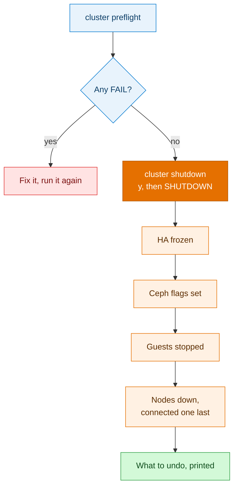

# Shut down or reboot a cluster

For a power cut, a datacenter move or a reboot of every node, [cluster shutdown](../cli/cluster/shutdown.md) and [cluster reboot](../cli/cluster/reboot.md) take the whole cluster down in order: HA first, then Ceph, then the guests, then the nodes.



## Check the cluster first

[cluster preflight](../cli/cluster/preflight.md) looks for what breaks a cluster while nodes come and go:

--8<-- "screens/infrastructure-preflight.html"

| Check | Fails or warns when |
|:--|:--|
| Nodes online | A node is offline. |
| PVE versions | Nodes run different releases (fail) or patch levels (warn). |
| Clock drift | Clocks differ by more than `--max-drift` seconds (2 by default). |
| Name resolution | A node does not list the others in `/etc/hosts` and has no DNS server. Pairs that rely on DNS are shown `n/a`: pvecli cannot check what the DNS answers. |
| Core services | `pve-cluster`, `pvedaemon`, `pveproxy` or `pvestatd` is not running. |
| Quorum | The cluster is not quorate. |
| Corosync links | The cluster has a single corosync link. |
| Quorum resilience | Two nodes without a QDevice: losing either one blocks the cluster. |

A `FAIL` exits with `1`. Fix it before going on.

## Shut down

`pvecli cluster shutdown` shows the plan, then asks twice: `y`, then `SHUTDOWN` typed in full (`REBOOT` for a reboot):

--8<-- "screens/infrastructure-shutdown-plan.html"

After the two answers, it runs these steps in order:

1. **HA.** If HA manages guests, pvecli disarms the HA stack in `freeze` mode (PVE 9.2 and later): every HA resource stays where it is and no node fences itself while its peers go down. On older versions it disables each started HA resource instead. `--skip-ha` leaves HA alone.
2. **Ceph.** If Ceph runs on the cluster, pvecli sets `noout`, `nobackfill`, `norecover` and `norebalance`, so Ceph neither marks OSDs out nor moves data while nodes disappear one by one. If it cannot tell whether Ceph is there, or cannot set a flag, it stops. `--skip-ceph` skips this step.
3. **Guests.** Each node stops its guests (`stopall`), waiting up to `--timeout` seconds per node (300 by default). Guests still running afterwards are named; the node shutdown stops them.
4. **Nodes.** pvecli sends the shutdown (or reboot) to each node, two seconds apart. The node your profile connects to goes last, so the API answers until the end.

It ends with the list of what to undo once the nodes are back:

```text
── After the nodes are back up, remember to: ──
  • Unset Ceph flags: pvecli ceph unset noout,nobackfill,norecover,norebalance -p prod
  • Re-arm HA: pvecli cluster ha arm

✓ Shutdown sent to every node
```

If you press ++ctrl+c++ or a step fails, pvecli stops and prints what it already changed (HA disarmed, flags set) with the command that undoes it.

!!! danger
    `-y` skips both questions. Nodes that are shut down do not come back by themselves: someone has to power them on.

## Bring the cluster back

Power the nodes on, then wait until every node is online and the cluster is quorate:

```bash
pvecli cluster health -p prod
```

Then undo what the shutdown set, in this order.

### Clear the Ceph flags

[ceph flags](../cli/ceph/flags.md) shows each OSD flag, whether it is set and what it does:

--8<-- "screens/infrastructure-ceph-flags.html"

Wait until every OSD is up ([ceph status](../cli/ceph/status.md)), then clear the four flags with [ceph unset](../cli/ceph/unset.md):

--8<-- "screens/infrastructure-ceph-unset.html"

A `noout` left behind hides a failed OSD: Ceph never marks it out and never rebuilds its data elsewhere. While a flag is set, Ceph reports `HEALTH_WARN`, so `ceph status` and `cluster health` keep warning.

[ceph set](../cli/ceph/set.md) sets flags by hand, with the same comma separated names, for work the cluster commands do not cover:

```bash
pvecli ceph set noout -p prod
```

### Re-arm HA

On PVE 9.2 and later, [cluster ha arm](../cli/cluster/ha.md#arm) re-arms the HA stack the shutdown disarmed:

```bash
pvecli cluster ha arm -p prod
```

`cluster health` shows the HA state on its `HA` line. [cluster ha disarm](../cli/cluster/ha.md#disarm) disarms it by hand, before any work during which nodes may lose each other: `--mode freeze` (the default) keeps every HA resource where it is, `--mode ignore` lets you manage them by hand. Both need PVE 9.2 or later; on older versions, disable the resources one by one (see [Make a guest highly available](../guests/ha.md)).

If the shutdown disabled HA resources instead (older versions), it lists them: enable them again the same way.

## Reboot

```bash
pvecli cluster reboot -p prod
```

Same plan and same steps, with a reboot sent to each node. The flags and the HA state stay as the reboot left them: clear and re-arm them as above once every node is back.

To take a single node out instead of the whole cluster, see [Put a node in maintenance](node-maintenance.md).
