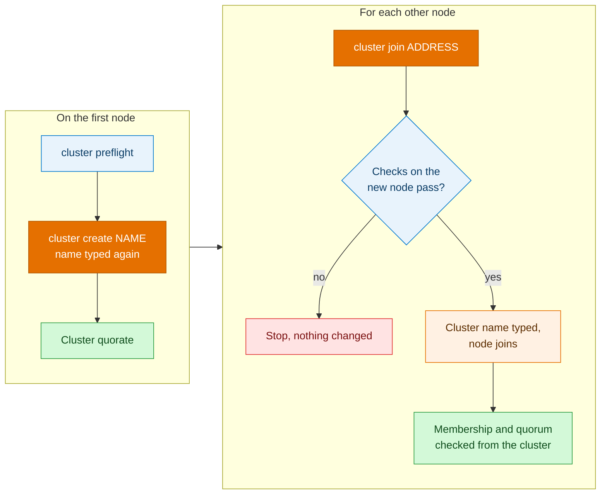

# Create or join a cluster

A fresh Proxmox VE install is a standalone node. [cluster create](../cli/cluster/create.md) makes it the first member of a cluster, and [cluster join](../cli/cluster/join.md) adds other standalone nodes to it. Neither can be undone through the API: leaving a cluster means reinstalling the node.



## Check the node first

Run [cluster preflight](../cli/cluster/preflight.md) on the profile of the standalone node:

--8<-- "screens/infrastructure-preflight-standalone.html"

On a standalone node it checks the version, the core services and the guests already there. The guests matter for a join: the joining node gets the `/etc/pve` of the cluster, and every guest, user, API token and storage defined on it alone is lost. Move or back them up first. Run the same command on the cluster you will join, for the versions, clocks and name resolution of its nodes (see [Shut down or reboot a cluster](cluster-power.md#check-the-cluster-first) for each check).

## Create the cluster

Point a profile at the standalone node, then give the cluster a name. A name cannot be changed later. pvecli shows the plan and asks you to type the name again:

--8<-- "screens/infrastructure-create.html"

`--link0` and `--link1` set the addresses of the node on corosync links 0 and 1. Give two links on two separate networks: with a single link, a network outage splits the cluster (preflight reports it as `Corosync links`).

```bash
pvecli cluster create staging --link0 10.1.0.11 --link1 10.2.0.11 -p staging
```

After the creation pvecli reconnects and waits until the cluster reports itself quorate, then prints the `cluster join` command to add the next node.

## Join a node

Run `cluster join` with the profile of the cluster, and the address of the node that joins:

```bash
export NEW_NODE_PW='...'
pvecli cluster join 10.1.0.12 --target-password-env NEW_NODE_PW -p staging
```

The join needs two passwords, never on the command line:

| Password | Option | Without the option |
|:--|:--|:--|
| `root` of the joining node | `--target-password-env VAR` | Asked at the terminal. |
| `root@pam` of the cluster | `--peer-password-env VAR` | Taken from the profile if it logs in as `root@pam` with a password, otherwise asked. |

Before joining, pvecli connects to the new node and stops if it already belongs to a cluster, if its Proxmox VE release differs from the cluster's (Proxmox VE refuses such a join), or if the clocks differ by more than 30 seconds. A different patch level or a few seconds of drift only warn. If the cluster uses two corosync links, give both with `--link0` and `--link1`, or pvecli refuses: the node would join without redundancy.

The plan names the node, the cluster, its members and the certificate fingerprint of the node pvecli joins through. Type the cluster name to confirm:

```text
Using the root@pam password from the profile for the peer

═══ Cluster join ═══

  Joining node:  pve7 (10.1.0.12)
  Target cluster: staging
  Existing members: pve6
  Peer:           10.1.0.11
  Fingerprint:    5A:0C:9E:41:7B:D2:63:18:AF:04:C7:92:3E:6B:F1:58:20:DE:93:4A:B7:0F:61:C5:8D:2E:74:B9:16:A3:CC:07
Warning: This operation cannot be undone through the API: leaving a cluster requires a reinstall of the node.
  Type the target cluster name 'staging' to confirm: staging

Joining pve7 to 'staging'...
Waiting for the node to appear in the cluster...
  members: pve6, pve7
✓ 'pve7' joined cluster 'staging', which is quorate
Update your pvecli profile if you want to reach the cluster through this node
```

The API drops the connection during the join by design: pvecli then checks the result from the cluster, not from the node. Check the new member with [cluster status](../cli/cluster/status.md) or [cluster health](../cli/cluster/health.md).

What each command needs from your user is listed in [Permissions](../reference/permissions.md).
