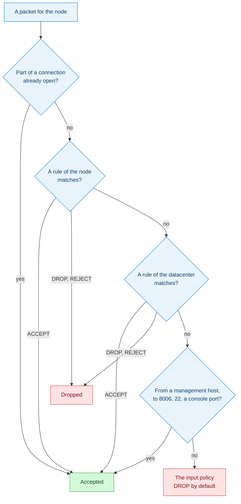

# Turn on the cluster firewall

The firewall of Proxmox VE has a switch at the datacenter. Off (the default), nothing is filtered, on any level. On, every node filters the traffic it receives, and every guest whose firewall is on filters its own (see [Filter a guest's traffic](../guests/firewall.md)).

The risk is the access to the cluster: once the datacenter switch is on, each node drops what no rule lets in, and pvecli reaches the cluster through port 8006 of one node. pvecli checks every change that could close that port to your machine before it writes it.

## How a node decides

For the traffic to the node itself (the web interface, the API, SSH), PVE 9.1 tries in this order, and the first answer wins:



- A security group inserted in the rules is tried in its place.
- The management hosts are the members of the IP set `management` of the datacenter. While that set does not exist, they are the hosts of the cluster network (the network of the node's cluster address). They reach ports 8006 (web interface and API), 22 (SSH), 5900 to 5999 and 3128 (consoles) and 60000 to 60050 (migration).
- A rule that drops your address comes before the management hosts: being one does not protect you from it.

## Look before you turn it on

[cluster firewall status](../cli/cluster/firewall.md#status) shows the datacenter, then every node and guest, and whether each is enforced:

--8<-- "screens/infrastructure-firewall-status.html"

[cluster firewall options](../cli/cluster/firewall.md#options) shows the options of the datacenter, with the defaults Proxmox VE applies:

--8<-- "screens/infrastructure-firewall-options.html"

Before turning it on, check that the guests whose firewall is on have their rules: their input policy, `DROP`, applies the moment the datacenter switch is on.

## Allow pvecli to change the cluster firewall

A change to the datacenter, a node, a security group or a vnet reaches every guest, or the access to the cluster itself. pvecli refuses those writes unless the profile has `firewall_write: true` in the [configuration file](../reference/config-file.md). The firewall of a single guest does not need it.

```text
Error: Firewall writes to datacenter are disabled for profile 'prod'.
```

## Choose the management hosts

Create the `management` IP set first, with the machines that administer the cluster. [cluster firewall ipset add](../cli/cluster/firewall.md#ipset-add) creates the set and adds the entries:

--8<-- "screens/infrastructure-firewall-management.html"

Once the set exists, only its members are management hosts, even while it is empty: the cluster network no longer is. pvecli refuses to create it, or to remove an entry from it, when this would leave your machine out while the firewall is on.

## Turn it on

[cluster firewall enable](../cli/cluster/firewall.md#enable) shows why your machine keeps its access, asks, then checks it once the change is applied:

--8<-- "screens/infrastructure-firewall-enable.html"

- `Access kept`: before writing, pvecli follows the order above for TCP 8006 from your address, with the configuration the change leaves.
- `A new connection to the API still works`: Proxmox VE loads the new rules within about ten seconds; pvecli then opens a new connection.

The same check runs before every change that can close the access: a rule of the datacenter or of the node pvecli talks to, a security group, the `management` set, an alias it uses, an option such as `policy_in`, an import. A change that closes it is refused:

--8<-- "screens/infrastructure-firewall-refused.html"

`--force` goes on anyway, for when another way in is ready.

!!! warning "If the access is lost"
    pvecli cannot undo a change once the API is closed: Proxmox VE also cuts the connections already open from an address it now drops. It says so, with the way back in. Open a shell on the node another way: its console (the web interface of another node, IPMI, a screen), or SSH if the change left port 22 open. Then run:

    ```bash
    pve-firewall stop
    ```

    Fix the rule from there, then `pve-firewall start`.

    The check sees your address as your machine sends it. Behind a NAT or a proxy, the node sees another one, and a rule on an interface (`--iface`) or an IP set pvecli cannot read is a case it cannot judge: it says so and stops, unless `--force`.

[cluster firewall disable](../cli/cluster/firewall.md#disable) turns the filtering off on every node and guest at once, with the rules kept.

## Write rules for the nodes

The rules of the datacenter apply to every node, the rules of a node only to it. They filter the traffic to the node, not to its guests:

```bash
pvecli cluster firewall rule add -ac ACCEPT -ma Ceph -src 10.1.0.0/24 -c "ceph network"
pvecli node firewall rule add pve1 -ac ACCEPT -pt tcp -dpt 9100 -src 10.0.0.30 -c "prometheus"
```

[node firewall set](../cli/node/firewall.md#set) changes the options of a node: `nftables=yes` (the nftables firewall, needed for the vnet rules), `nf_conntrack_max`, `tcpflags`, `nosmurfs`, the log levels. [node firewall disable](../cli/node/firewall.md#disable) leaves one node unfiltered while the datacenter firewall stays on.

## Share rules with security groups

A security group is a named list of rules, kept at the datacenter, that a level inserts as one rule. [cluster firewall group add](../cli/cluster/firewall.md#group-add) creates it, `rule add -g` fills it, and a guest or a node inserts it with its name as the action:

```bash
pvecli cluster firewall group add webserver -c "web servers"
pvecli cluster firewall rule add -g webserver -ac ACCEPT -ma HTTPS
pvecli cluster firewall rule add -g webserver -ac ACCEPT -ma HTTP
pvecli ct firewall rule add 891 -ac webserver
```

[cluster firewall group info](../cli/cluster/firewall.md#group-info) shows its rules and the levels that insert it:

--8<-- "screens/infrastructure-firewall-group-info.html"

A change to the group applies everywhere it is inserted. [group rename](../cli/cluster/firewall.md#group-rename) renames it where it is inserted too. [group remove](../cli/cluster/firewall.md#group-remove) refuses while a level still inserts it.

## Name addresses for the whole cluster

The aliases and IP sets of the datacenter can be named in the rules of every level:

```bash
pvecli cluster firewall alias add admin-net 10.0.0.0/24 -c admins
pvecli cluster firewall ipset add monitoring 10.0.0.30 10.0.0.31
pvecli vm firewall rule add 890 -ac ACCEPT -ma SSH -src admin-net
```

A guest names them as `admin-net` and `+monitoring` when it has no alias or set of that name, or as `dc/admin-net` and `+dc/monitoring` to be explicit. [cluster firewall refs](../cli/cluster/firewall.md#refs) lists the names a rule can use. A rename with `--rename` rewrites the rules that use the name, on every level. A removal is refused while a rule uses it, unless `--force`.

## Check what is enforced

Once it is on, `status` says which levels are enforced, and the `Issues` column names what Proxmox VE accepts without a word but does not apply: a rule broken by a missing alias, a guest with rules and its firewall off, a card without `firewall=1`, vnet rules on nodes without nftables:

--8<-- "screens/infrastructure-firewall-status-on.html"

[audit](../cli/audit.md) reports the same problems, among the others it checks (see [Audit a cluster](../fleet/audit.md)). To keep the whole firewall in a file and apply it again: [Keep the firewall in a file](../fleet/firewall.md).

The firewall of a vnet filters the traffic routed between its guests, under [sdn vnet firewall](../cli/sdn/vnet.md#firewall-status), with the same commands. It needs PVE 8.3 or later and the nftables firewall on the nodes.
