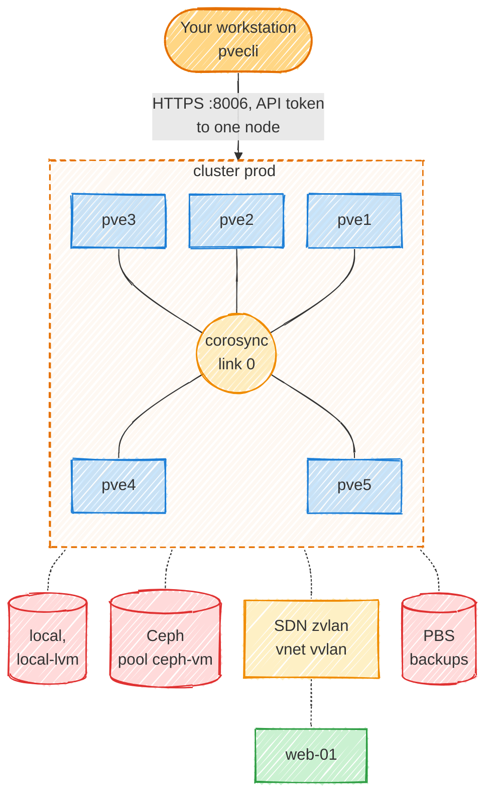

# Infrastructure

This section covers the cluster itself: its health and capacity, its nodes, their storage, the SDN and Ceph. It also covers the operations that touch every node at once: maintenance, a full shutdown or reboot, and building a cluster from standalone nodes. On call, start with [Check cluster health](health.md).

pvecli talks to one node of the cluster through the API, and that node answers for all of them: [cluster](../cli/cluster/index.md) and [node](../cli/node/index.md) for the nodes and corosync, [storage](../cli/storage/index.md) for the storages, [sdn](../cli/sdn/index.md) for the zones and vnets guests attach to, [ceph](../cli/ceph/index.md) for the Ceph cluster the nodes run.

-   :lucide-activity:{ .lg } __Check cluster health__

    ---

    Quorum, failure tolerance, HA and Ceph in one view, then what is wrong.

    [:lucide-arrow-right: Check cluster health](health.md)

-   :lucide-gauge:{ .lg } __Check capacity and usage__

    ---

    What the nodes consume, what the guests are given, how full the storage is.

    [:lucide-arrow-right: Check capacity and usage](usage.md)

-   :lucide-wrench:{ .lg } __Put a node in maintenance__

    ---

    Empty a node, keep Ceph quiet, work on it, bring it and its guests back.

    [:lucide-arrow-right: Put a node in maintenance](node-maintenance.md)

-   :lucide-power-off:{ .lg } __Shut down or reboot a cluster__

    ---

    Every node in order, with HA and Ceph kept quiet, then the way back.

    [:lucide-arrow-right: Shut down or reboot a cluster](cluster-power.md)

-   :lucide-network:{ .lg } __Create or join a cluster__

    ---

    Turn a standalone node into a cluster, then add nodes to it.

    [:lucide-arrow-right: Create or join a cluster](create-join.md)

-   :lucide-hard-drive:{ .lg } __Add and manage storage__

    ---

    Shared storage checked from every node, ISO images, templates.

    [:lucide-arrow-right: Add and manage storage](storage.md)

-   :lucide-waypoints:{ .lg } __Manage SDN zones and vnets__

    ---

    Zones, vnets and subnets, then apply or discard the changes.

    [:lucide-arrow-right: Manage SDN zones and vnets](sdn.md)

-   :lucide-database:{ .lg } __Inspect Ceph__

    ---

    Health, OSDs, pools, flags, versions and the Ceph log.

    [:lucide-arrow-right: Inspect Ceph](ceph.md)

[Check cluster health](health.md){ .md-button .md-button--primary }
