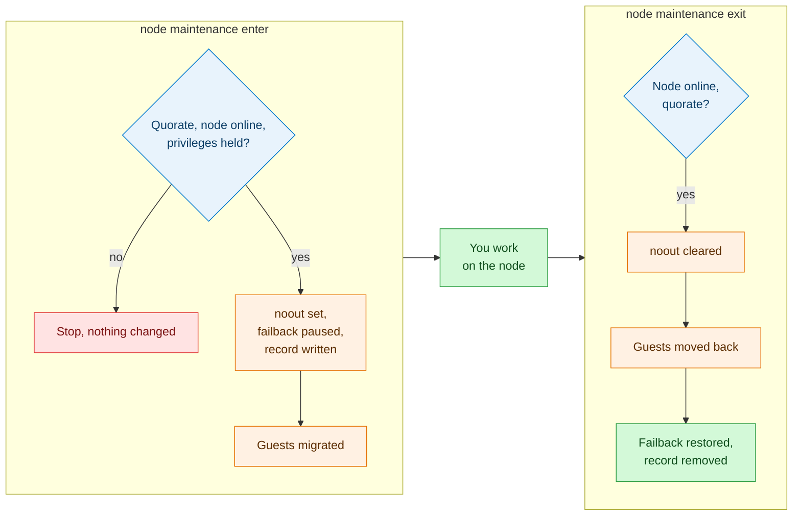

# Put a node in maintenance

To upgrade, repair or reboot one node while the cluster keeps running, move its guests away first, keep Ceph from rebalancing while it is down, then bring everything back. Check the cluster before you start: [Check cluster health](health.md).



## See what an upgrade brings

[node updates](../cli/node/updates.md) counts the pending packages of each node, the Proxmox VE ones apart, and the newest kernel among them:

--8<-- "screens/infrastructure-updates.html"

A node with a new kernel needs a reboot after the upgrade. The list comes from the last `apt update` of each node; `--refresh` runs one first (nothing is installed), and `--packages` lists every package with its old and new version.

## Enter maintenance

[node maintenance enter](../cli/node/maintenance.md#enter) moves the guests of the node to another one, sets the Ceph `noout` flag so the OSDs of the node going down trigger no rebalance, and records what it did. It shows the plan first:

--8<-- "screens/infrastructure-maintenance-enter.html"

1. The guests go to the online node with the most free memory, here `pve3`. Choose it with `-t pve5`.
2. `noout` is set only if Ceph runs on the cluster and the flag is not already set. `--no-ceph-flag` skips it.

Running VMs move live. Containers cannot, so a running container is restarted on the target. VMs with local disks need `--with-local-disks`. If HA manages some of the guests and HA uses rules (PVE 9), pvecli pauses their failback until you exit maintenance, so HA does not pull them back each time the node reboots. With HA groups (PVE 8, or a PVE 9 cluster whose groups are not converted yet), it prints the `ha-manager` command to run on the node instead.

Before changing anything, pvecli checks that your user holds the privileges the maintenance needs, and stops if one is missing (see [Permissions](../reference/permissions.md)).

!!! warning
    The record of the maintenance is kept in `~/.config/pvecli/maintenance/` on the machine that ran `enter`. Run `exit` from the same machine, or the Ceph flag and the guests stay where they are.

[node maintenance status](../cli/node/maintenance.md#status) lists the nodes in maintenance from these records:

```text
$ pvecli node maintenance status
┏━━━━━━━━━┳━━━━━━┳━━━━━━━━━━━━┳━━━━━━━━━━━━━━━━━━━━━┳━━━━━━━━━━━━━━━━━┳━━━━━━━━━━━━━━━━━━━━━┓
┃ Cluster ┃ Node ┃ By profile ┃ Since               ┃ Guests moved to ┃ noout set by pvecli ┃
┡━━━━━━━━━╇━━━━━━╇━━━━━━━━━━━━╇━━━━━━━━━━━━━━━━━━━━━╇━━━━━━━━━━━━━━━━━╇━━━━━━━━━━━━━━━━━━━━━┩
│ prod    │ pve4 │ prod       │ 2026-11-19 10:12:40 │ 3 -> pve3       │ yes                 │
└─────────┴──────┴────────────┴─────────────────────┴─────────────────┴─────────────────────┘
```

## Work on the node

The node is empty: upgrade it, reboot it, power it off. [node ssh](../cli/node/ssh.md) opens a shell on it (user, port and key from the profile, or `-u`, `-P`, `-i`); `-c` runs one command:

```bash
pvecli node ssh pve4 -c "apt full-upgrade -y" -p prod
```

[node vnc](../cli/node/vnc.md) opens the node shell of the web UI in your browser instead, which needs no SSH access but a profile that logs in with a password.

[node reboot](../cli/node/reboot.md) and [node shutdown](../cli/node/shutdown.md) ask before sending the command:

--8<-- "screens/infrastructure-node-reboot.html"

Proxmox VE stops the guests still on the node before it goes down. When the node is the one your profile connects to, pvecli warns that you lose access until it is back.

## Exit maintenance

[node maintenance exit](../cli/node/maintenance.md#exit) waits for the node to be online (600 seconds, `--wait` to change), checks that the cluster is quorate, clears `noout` and moves the guests back:

```bash
pvecli node maintenance exit pve4 -p prod
```

It asks before moving the guests back, and restores the HA failback it paused. `--no-return` leaves the guests where they are. If other nodes of the cluster are still in maintenance, `noout` stays set and is cleared when the last one exits.

## Move the guests without maintenance

[node evacuate](../cli/node/evacuate.md) only moves the guests of a node to another one, without the Ceph flag and without a record:

--8<-- "screens/infrastructure-evacuate.html"

It is the same as `pvecli cluster guests migrate pve5 --node pve4`. `--max-workers` sets how many migrations run at the same time. To move a single guest, see [Migrate a guest](../guests/migrate.md).
