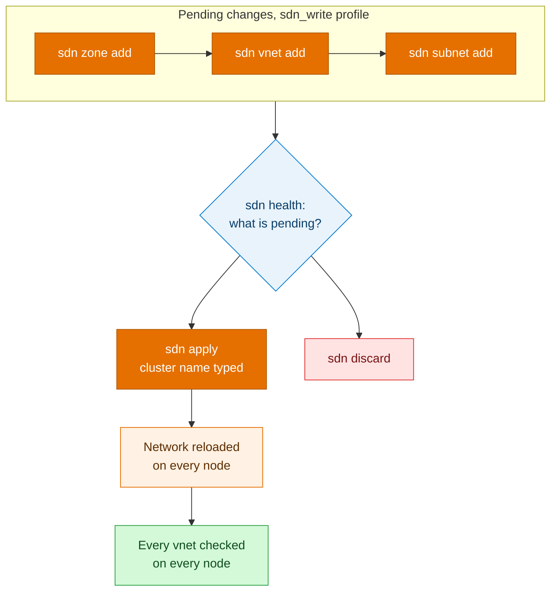

# Manage SDN zones and vnets

The software-defined network (SDN) of Proxmox VE has three levels: a zone (the technology: simple, VLAN, QinQ, VXLAN, EVPN), its vnets (the bridges guests attach to) and their subnets. Every change stays pending until it is applied on all nodes at once.



## See the SDN

[sdn zones](../cli/sdn/zones.md) lists the zones, the nodes they are restricted to, and on how many nodes each one is really deployed:

--8<-- "screens/infrastructure-sdn-zones.html"

[sdn list](../cli/sdn/list.md) lists the vnets with their zone, tag and the number of nodes where the vnet is available:

--8<-- "screens/infrastructure-sdn-list.html"

A vnet on fewer nodes than the cluster has (`3/5`) cannot carry a guest that moves to one of the missing nodes. [sdn info](../cli/sdn/info.md) details one vnet: its definition, its subnets with their gateway, SNAT and DHCP range, and every guest with an interface on it.

## Check for unapplied changes

[sdn health](../cli/sdn/health.md) reports pending changes, vnets missing on some nodes, vnets in error, and zones that serve DHCP without an IPAM (dnsmasq then never gives a lease):

--8<-- "screens/infrastructure-sdn-health.html"

Run it before a maintenance: pending changes left by someone else would be applied by the next `sdn apply`, whoever runs it.

## Allow SDN changes on a profile

Applying SDN reloads the network of every node, so pvecli refuses any SDN change unless the profile allows it:

--8<-- "screens/infrastructure-sdn-refused.html"

Add `sdn_write: true` to the profile in the [configuration file](../reference/config-file.md). The read commands above work on every profile.

## Add a zone, a vnet and a subnet

[sdn zone add](../cli/sdn/zone.md#add) creates a zone. Each type needs its own options: `-b` (bridge) for `vlan` and `qinq`, `--tag` for `qinq`, `--peers` for `vxlan`, `--controller` and `--vrf-vxlan` for `evpn`. Without `-t`, pvecli asks for the type and for each value, with the bridges of a node or the controllers in a menu.

```bash
pvecli sdn zone add zdmz -t vlan -b vmbr1 -p prod
```

[sdn vnet add](../cli/sdn/vnet.md#add) creates a vnet in a zone. Every zone type except `simple` needs a tag (VLAN tag, or VNI for VXLAN and EVPN). Names of zones and vnets are 2 to 8 letters and digits, starting with a letter:

```bash
pvecli sdn vnet add vnet9 -z zdmz --tag 50 -a "Backup VLAN" -p prod
```

[sdn subnet add](../cli/sdn/subnet.md#add) attaches a subnet, with its gateway, SNAT and a DHCP range:

```bash
pvecli sdn subnet add 10.0.50.0/24 -v vnet9 -g 10.0.50.1 --snat -p prod
```

A DHCP range (`--dhcp-range 10.0.50.100:10.0.50.200`) only serves leases if the zone has DHCP enabled; pvecli warns when it does not, with the [sdn zone set](../cli/sdn/zone.md#set) command that enables it.

Each command shows a summary and asks before writing (`-y` skips the question), then reminds you that the change is pending. [sdn vnet remove](../cli/sdn/vnet.md#remove) refuses while guests use the vnet, and [sdn zone remove](../cli/sdn/zone.md#remove) while vnets use the zone.

## Apply

[sdn apply](../cli/sdn/apply.md) lists the pending changes and the nodes it will reload, then asks you to type the cluster name:

```text
═══ Apply SDN ═══

  zone zdmz new
  vnet vnet9 new
  subnet 10.0.50.0/24 on vnet9 new

  Cluster: prod
  Nodes:   pve1, pve2, pve3, pve4, pve5
Warning: Applying reloads the network configuration on every node listed above. Guests attached to a modified vnet can lose connectivity for a moment.
  Type the cluster name 'prod' to confirm: prod
✓ SDN configuration applied
✓ Every vnet is available on the 5 node(s)
```

pvecli waits for the reload task, then checks that every vnet is available on every node. If the reload fails, the configuration stays pending and the task log is in [cluster tasks](../cli/cluster/tasks.md).

`--force` applies even with nothing pending, to write the configuration of the nodes again.

!!! note "PVE 9.2 and later"
    Before asking, `sdn apply` shows what the reload changes in the network interfaces and the FRR routing of the first node (`--no-diff` to skip it). It also holds the global SDN lock during the apply, so no change from the web UI or another tool slips in between. Older versions have neither.

## Discard or unlock

[sdn discard](../cli/sdn/discard.md) drops every pending change and goes back to the applied configuration. It lists what it drops and asks first.

When an apply is refused because the SDN configuration is locked, another session (web UI, Proxmox Datacenter Manager, Terraform) holds the lock. Wait for it to finish. If that session is gone and the lock stayed, [sdn unlock](../cli/sdn/unlock.md) releases it.
