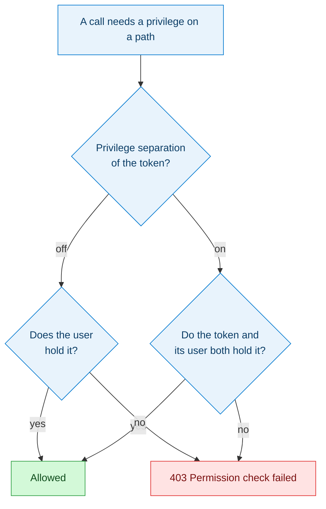

# Permissions

pvecli acts with the rights of the profile's user or API token: Proxmox VE decides what each call may do. This page lists the privileges behind each command, then what pvecli checks or needs on top of them.

## Privileges of an API token

A token created with privilege separation on has only the privileges granted to the token itself, and among those only the ones its user also holds. With privilege separation off, it holds every privilege of its user.



[audit](../cli/audit.md) reports the tokens with privilege separation off, as a warning when the user is `root@pam`.

## Privileges by command

The privileges Proxmox VE checks on the main call behind each command, from the API schema of Proxmox VE 9.1. `ID` is the guest, `NODE` the node, `NAME` the pool. Every command also reads the cluster to find the guest or the node: what you cannot see is reported as not found. The SDN commands that write also need `sdn_write: true` on the profile (see below).

| Command | Privilege |
|:--|:--|
| [vm start](../cli/vm/start.md), `stop`, `shutdown`, `reboot`, `suspend`, `resume`, and the same `ct` commands | `VM.PowerMgmt` on `/vms/ID` |
| [cluster guests](../cli/cluster/guests.md) `start`, `shutdown`, `suspend` | `VM.PowerMgmt` on `/` or on each `/vms/ID` |
| [vm migrate](../cli/vm/migrate.md), [ct migrate](../cli/ct/migrate.md) | `VM.Migrate` on `/vms/ID` |
| [node evacuate](../cli/node/evacuate.md), [cluster guests migrate](../cli/cluster/guests.md#migrate) | `VM.Migrate` on `/` or on each `/vms/ID` |
| [vm clone](../cli/vm/clone.md), [ct clone](../cli/ct/clone.md) | `VM.Clone` on the source, `VM.Allocate` on `/vms/NEWID` or on the pool, `Datastore.AllocateSpace` on the target storage, `SDN.Use` on the bridge |
| [vm add](../cli/vm/add.md), [ct add](../cli/ct/add.md), [vm deploy](../cli/vm/deploy.md), [ct deploy](../cli/ct/deploy.md), [deploy](../cli/deploy.md) | Same as a clone for a template ID. A new guest: `VM.Allocate` on `/vms/ID` or on the pool, `Datastore.AllocateSpace` on the storage, `SDN.Use` on the bridge; a privileged container also needs `Sys.Modify` on `/` |
| [vm remove](../cli/vm/remove.md), [ct remove](../cli/ct/remove.md), [vm template](../cli/vm/template.md), [ct template](../cli/ct/template.md) | `VM.Allocate` on `/vms/ID` |
| [vm edit](../cli/vm/edit.md), [ct edit](../cli/ct/edit.md) | The `VM.Config.*` privilege of each changed setting (`CPU`, `Memory`, `Disk`, `Network`, `Options`...) on `/vms/ID`. A pool change: `Pool.Allocate` on the pools |
| [vm tag](../cli/vm/tag.md), [ct tag](../cli/ct/tag.md) | `VM.Config.Options` on `/vms/ID` |
| [tag add](../cli/tag/add.md), [tag edit](../cli/tag/edit.md), [tag remove](../cli/tag/remove.md) | `Sys.Modify` on `/` for the colors (a cluster option), `VM.Config.Options` on each guest whose tags change |
| [vm cloudinit set](../cli/vm/cloudinit.md#set) | `VM.Config.Cloudinit` on `/vms/ID` |
| [vm snapshot](../cli/vm/snapshot.md), [ct snapshot](../cli/ct/snapshot.md), [snapshot add](../cli/snapshot/add.md), [snapshot prune](../cli/snapshot/prune.md) | `VM.Snapshot` on `/vms/ID`. `rollback`: `VM.Snapshot` or `VM.Snapshot.Rollback` |
| [vm vnc](../cli/vm/vnc.md), [ct vnc](../cli/ct/vnc.md) | `VM.Console` on `/vms/ID` |
| [node vnc](../cli/node/vnc.md) | `Sys.Console` on `/nodes/NODE` |
| [vm exec](../cli/vm/exec.md) | `VM.GuestAgent.Unrestricted` on `/vms/ID` (`VM.Monitor` on Proxmox VE 8) |
| [vm ha](../cli/vm/ha.md), [ct ha](../cli/ct/ha.md) | `Sys.Console` on `/` |
| [backup run](../cli/backup/run.md) | `VM.Backup` on each guest, `Datastore.AllocateSpace` on the backup storage |
| [backup restore](../cli/backup/restore.md) | To a new ID: `VM.Allocate` on `/vms/ID` and `Datastore.AllocateSpace` on the target storage. Over an existing guest: `VM.Backup` on it |
| [backup remove](../cli/backup/remove.md), [backup prune](../cli/backup/prune.md) | `Datastore.Allocate` on the storage, or `Datastore.AllocateSpace` with `VM.Backup` on the guest |
| [backup jobs](../cli/backup/jobs.md) `list` | `Sys.Audit` on `/` |
| [backup jobs](../cli/backup/jobs.md) `add`, `edit`, `remove`, `enable`, `disable` | `Sys.Modify` on `/` |
| [node shutdown](../cli/node/shutdown.md), [node reboot](../cli/node/reboot.md) | `Sys.PowerMgmt` on `/nodes/NODE` |
| [node updates](../cli/node/updates.md) | `Sys.Modify` on `/nodes/NODE`, to read the list too |
| [ceph set](../cli/ceph/set.md), [ceph unset](../cli/ceph/unset.md) | `Sys.Modify` on `/` |
| [pool add](../cli/pool/add.md), [pool remove](../cli/pool/remove.md) | `Pool.Allocate` on `/pool/NAME`. Adding or removing a member also needs the right to change the permissions of that guest or storage |
| [storage add](../cli/storage/add.md), [storage config](../cli/storage/config.md), [storage remove](../cli/storage/remove.md) | `Datastore.Allocate` on `/storage` |
| [storage content download](../cli/storage/content.md#download) | `Datastore.AllocateTemplate` on the storage, and `Sys.AccessNetwork` on `/nodes/NODE` (or `Sys.Audit` or `Sys.Modify` on `/`) |
| [storage content remove](../cli/storage/content.md#remove) | `Datastore.Allocate` on the storage (a backup: `Datastore.AllocateSpace` with `VM.Backup` on its guest) |
| [sdn apply](../cli/sdn/apply.md), [sdn discard](../cli/sdn/discard.md), [sdn unlock](../cli/sdn/unlock.md) | `SDN.Allocate` on `/sdn` |
| [sdn zone](../cli/sdn/zone.md), [sdn vnet](../cli/sdn/vnet.md) `add` | `SDN.Allocate` on `/sdn/zones/ZONE` |
| [sdn vnet](../cli/sdn/vnet.md) `remove`, [sdn subnet](../cli/sdn/subnet.md) | `SDN.Allocate` on `/sdn/zones/ZONE/VNET` |
| [cluster create](../cli/cluster/create.md), [cluster join](../cli/cluster/join.md) | `root@pam` only |

## Firewall

Each level of the firewall has its own privilege, from the code of Proxmox VE 9.1. Reading needs the first, any change the second. `ZONE` and `VNET` are the SDN zone and vnet.

| Level | Read | Change |
|:--|:--|:--|
| Datacenter, security groups, and their aliases and IP sets ([cluster firewall](../cli/cluster/firewall.md)) | `Sys.Audit` on `/` | `Sys.Modify` on `/` |
| Node ([node firewall](../cli/node/firewall.md)) | `Sys.Audit` on `/nodes/NODE` | `Sys.Modify` on `/nodes/NODE` |
| Guest ([vm firewall](../cli/vm/firewall.md), [ct firewall](../cli/ct/firewall.md)) | `VM.Audit` on `/vms/ID` | `VM.Config.Network` on `/vms/ID`, which `--nics` also needs |
| Vnet ([sdn vnet firewall](../cli/sdn/vnet.md#firewall-status)) | `SDN.Audit` or `SDN.Allocate` on `/sdn/zones/ZONE/VNET` | `SDN.Allocate` on `/sdn/zones/ZONE/VNET` |

The log takes another privilege: `Sys.Syslog` on `/nodes/NODE` for [node firewall log](../cli/node/firewall.md#log), `VM.Console` on `/vms/ID` for [vm firewall log](../cli/vm/firewall.md#log). [cluster firewall status](../cli/cluster/firewall.md#status), `export` and `import` read every level, and skip the guests and vnets you cannot see. Changes to the datacenter, a node, a security group or a vnet also need `firewall_write: true` on the profile (see below).

## Refused calls

When Proxmox VE refuses a call, pvecli names the method and path of the call, followed by the reason Proxmox VE gives, which usually names the missing privilege and the path it is checked on:

```text
Error: Permission denied: POST /pools: Permission check failed (/pool/web, Pool.Allocate)
```

## Commands with their own requirements

| Command | Needs |
|:--|:--|
| [vm lock](../cli/vm/lock.md), [vm unlock](../cli/vm/unlock.md) | A `root@pam` profile. |
| [node vnc](../cli/node/vnc.md) | A profile with `type: password`. pvecli refuses API tokens for the node shell. |
| [cluster join](../cli/cluster/join.md) | The password of `--target-user` (default `root@pam`) on the joining node, and the `root@pam` password of the cluster. A `root@pam` password profile provides the second one. |
| [backup jobs run](../cli/backup/jobs.md#run) | Only `root@pam` may tie the run to its job ID. For other users pvecli warns `job-id refused` and runs the same backup without it. |
| [node maintenance enter](../cli/node/maintenance.md#enter), [node maintenance exit](../cli/node/maintenance.md#exit) | `VM.Migrate` on each guest moved; `Sys.Modify` on `/` to set or clear the Ceph `noout` flag (skip it with `--no-ceph-flag`); `Sys.Console` on `/` to pause and resume HA failback when HA uses rules. pvecli checks these first and changes nothing if one is missing. |
| [sdn apply](../cli/sdn/apply.md), [sdn discard](../cli/sdn/discard.md), [sdn unlock](../cli/sdn/unlock.md), [sdn zone](../cli/sdn/zone.md) `add`, `set` and `remove`, [sdn vnet](../cli/sdn/vnet.md) and [sdn subnet](../cli/sdn/subnet.md) `add` and `remove` | `sdn_write: true` on the profile, in the [configuration file](config-file.md). This is a pvecli setting, not a Proxmox VE privilege. |
| The commands of [cluster firewall](../cli/cluster/firewall.md), [node firewall](../cli/node/firewall.md) and [sdn vnet firewall](../cli/sdn/vnet.md#firewall-status) that write, and [cluster firewall import](../cli/cluster/firewall.md#import) of a file that names those levels | `firewall_write: true` on the profile, in the [configuration file](config-file.md). The firewall of a guest does not need it. |

## Results that depend on what you can see

Proxmox VE leaves out of a list what the user may not see, without an error. pvecli checks the privileges below and says when a result is incomplete, instead of showing an empty or short list as complete.

| Command | Privilege | Without it |
|:--|:--|:--|
| [find](../cli/find.md), [snapshot list](../cli/snapshot/list.md) | `VM.Audit` on `/vms` | Guests outside your pools are not listed. |
| [backup list](../cli/backup/list.md), [backup status](../cli/backup/status.md) | `VM.Backup` on the guest | Its backups are hidden. |
| | `Datastore.AllocateSpace` on the backup storage | The backups on that storage are hidden. |
| [backup status](../cli/backup/status.md) | `Sys.Audit` on `/nodes/<node>` | The last backup runs on that node are unknown. |
| [audit](../cli/audit.md) | `Sys.Audit` or `User.Modify` on `/access/groups` | Hidden users and their tokens are not checked. |
| | `Sys.Audit` on `/access` | ACL entries are not checked. |
| | `VM.Audit` on `/vms` | Snapshots of the hidden guests are not checked, and orphan disks not at all. |
| | `Datastore.Audit` or `Datastore.Allocate` on `/storage` | Orphan disks are not checked at all. |
| | `VM.Config.Disk` on `/vms`, or `Datastore.Allocate` on the storage | Orphan disks on that storage are not found. |

## Who has access to a guest

`pvecli find --access` lists the ACL entries that grant access to a guest, and `--user` what a user or an API token can reach: see [Find a guest, an address or a disk](../fleet/find.md#who-has-access-to-a-guest).
