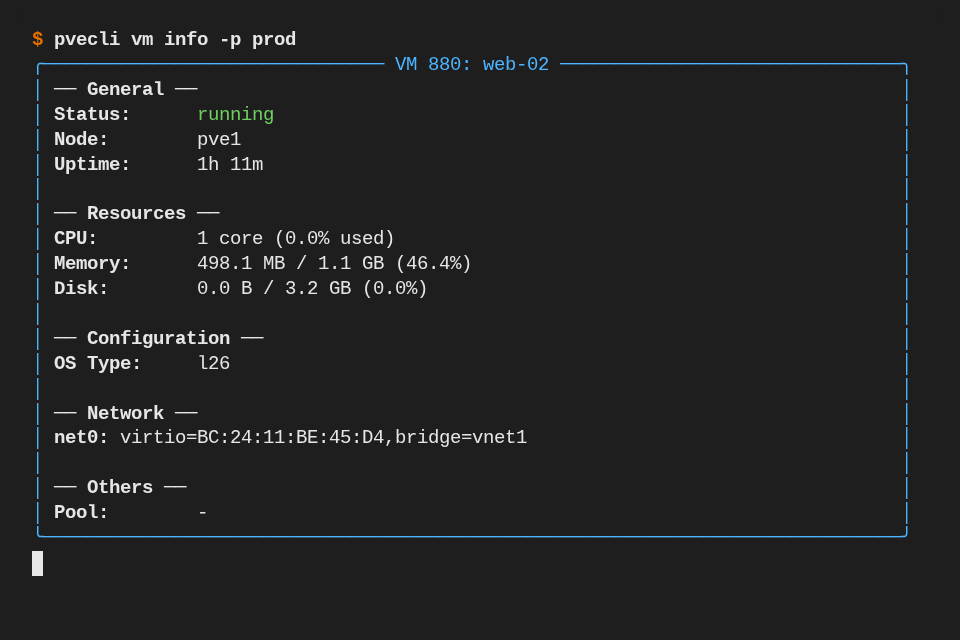
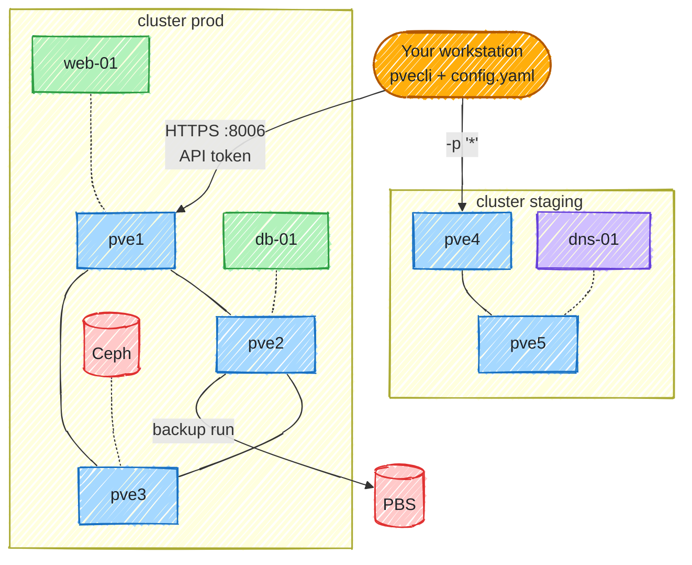
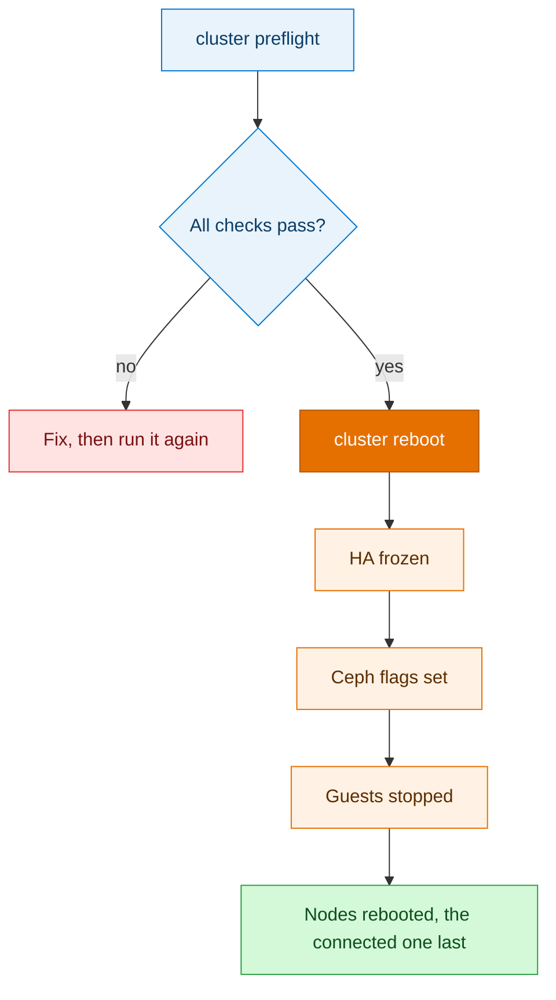
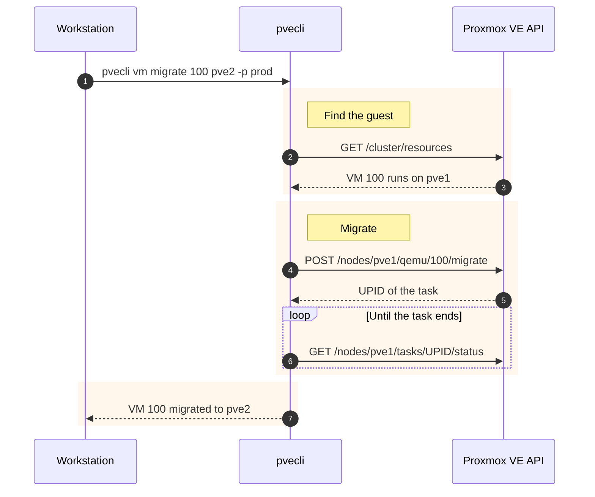
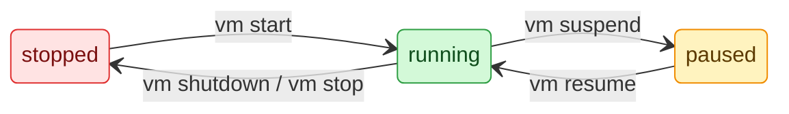

# Page elements

This page shows every element the documentation can use, filled with real
pvecli content. It is not in the menu: it is a sample to choose from.

## Text

A paragraph with **bold**, *italic*, `inline code`, a [link to a command](cli/vm/start.md),
==highlighted text==, ^^inserted text^^, ~~deleted text~~, H~2~O and
2^10^. Keys: ++ctrl+c++, ++enter++, ++arrow-up++. Highlighted inline code:
`#!bash pvecli vm list -p prod`.

The PBS keeps the backups. An abbreviation gets a tooltip, like PBS
above.[^1] Hover [this link](start/connect.md "Create an API token first")
for its tooltip.

[^1]: A footnote: shown at the bottom of the page, and as a tooltip.

*[PBS]: Proxmox Backup Server

> A quote. Used rarely, for a message from Proxmox VE itself:
> `TASK ERROR: VM is locked (backup)`.

---

## Admonitions

!!! note
    `-p` takes a profile, a list (`prod,staging`), a pattern (`'lab*'`) or `'*'`.

!!! tip "Faster on many guests"
    `--max-workers` sets how many guests are handled at the same time.

!!! warning
    `vm stop` powers the guest off at once. Unsaved data is lost.

!!! danger
    `backup restore --force` overwrites the guest. Its current disks are gone.

!!! info
    pvecli needs Proxmox VE 8 or 9.

!!! example
    `pvecli find 10.0.0.31 -p '*'` looks for an address on every cluster.

??? question "Collapsed: why an API token and not a password?"
    A token can be revoked alone, holds only the privileges you give it, and
    never asks for a second factor.

???+ abstract "Open by default"
    The same block, open when the page loads.

!!! note inline end "Beside the text"
    An admonition can sit beside a paragraph.

A paragraph next to the admonition on the right. It wraps around it on a
wide screen and falls below it on a phone. Useful for a short side remark
that should not interrupt the reading.

## Commands and code

A command to type:

```bash
pvecli vm start 100-105 -p prod
```

With a title, line numbers and highlighted lines:

```bash title="nightly.sh" linenums="1" hl_lines="3 4"
#!/bin/sh
set -e
pvecli snapshot add nightly --tag web -y -p prod
pvecli backup run --tag web --storage pbs -y -p prod
```

A configuration file, with annotations (click the numbers):

```yaml title="~/.config/pvecli/config.yaml"
default_profile: prod # (1)!
profiles:
  prod:
    host: 10.0.0.11
    port: 8006
    verify_ssl: false # (2)!
    auth:
      type: token
      user: pvecli@pve
      token_name: automation # (3)!
      token_value: AGE:YWdlLWVuY3J5cHRpb24ub3JnL3YxCi0+IFgyNTUxOSB3Z2...
```

1. Used when `-p` is missing.
2. A default Proxmox VE certificate is self-signed.
3. The token is created in *Datacenter > Permissions > API Tokens*.

## Terminal output

A real capture, with the real colors:

--8<-- "screens/home-health.html"

A wide one, in a smaller font:

--8<-- "screens/backups-list.html"

A hand-written output, for what cannot be captured:

```text
^C
Interrupted. Already changed:
  • Ceph flags set: pvecli ceph unset noout,nobackfill,norecover,norebalance -p prod
```

## Recording

An interactive menu, recorded in a real terminal: it plays when it comes
into view. The bar below shows where it is and lets you pause it or jump
in it.

<div class="cast" data-src="../assets/casts/start-vm-info-menu.cast" data-poster="npt:0:3" data-rows="22"></div>

## Video

The same session as a video file, for what is not a terminal (a web page,
a console):

<video controls muted playsinline preload="metadata" poster="../assets/videos/vm-info-menu-poster.jpg" style="width: 100%; border-radius: 0.2rem">
  <source src="../assets/videos/vm-info-menu.mp4" type="video/mp4">
</video>

## Images

An image with a caption:

<figure markdown="span">
  { width="560" }
  <figcaption>The summary of a VM: status, resources, network, pool.</figcaption>
</figure>

An image beside the text:

{ align=right width="260" }

`vm info` without an ID opens a menu of the guests, then shows the summary of
the one you pick. The image floats on the right on a wide screen and goes
above the text on a phone.

<div style="clear: both"></div>

## Diagrams

### Sketch

A diagram drawn by hand, like Excalidraw: for the big picture of a page.
The same Mermaid text, with `look: handDrawn`, inside a `sketch` block.

<div class="sketch" markdown>



</div>

### Flow

A flow, one color per kind of step:



### Sequence

What pvecli asks the API, numbered, with each phase on a band:



### States

The states of a guest:



## Tables

| Option | Default | What it does |
|:--|:--:|:--|
| `--timeout` | `60` | Seconds to wait for a shutdown. |
| `--force` | off | Stop the guest if the shutdown times out. |
| `-y`, `--yes` | off | Do not ask first. |

## Tabs

=== "pipx"

    ```bash
    pipx install git+https://github.com/Helphyy/pvecli.git
    ```

=== "pip"

    ```bash
    python -m venv .venv && . .venv/bin/activate
    pip install git+https://github.com/Helphyy/pvecli.git
    ```

=== "uv"

    ```bash
    uv tool install git+https://github.com/Helphyy/pvecli.git
    ```

When something differs between versions:

=== "PVE 9"

    `cluster ha disarm` freezes HA in one call.

=== "PVE 8"

    pvecli disables each started HA resource one by one.

## Lists

1. Create the token.
2. Run `pvecli config add prod`.
3. Run `pvecli config test -p prod`.

A bullet list:

- Unordered item
    - Nested item

A task list:

- [x] HA frozen
- [x] Ceph flags set
- [ ] Nodes back online

A definition list:

`--node`
:   Only the guests that run on this node.

`--tag`
:   Only the guests that carry this tag.

## Icons

Icons inline: :lucide-server: node, :lucide-monitor: VM, :lucide-box:
container, :lucide-hard-drive: storage, :lucide-database: Ceph,
:lucide-archive: backup.

## Buttons

[Get started](start/index.md){ .md-button .md-button--primary }
[All commands](cli/index.md){ .md-button }

## Grids

Cards, for a section index:

<div class="grid cards" markdown>

-   :lucide-monitor:{ .lg } __Guests__

    ---

    Create, run, migrate and snapshot VMs and containers.

    [:lucide-arrow-right: Guests](guests/index.md)

-   :lucide-server:{ .lg } __Infrastructure__

    ---

    Health, nodes, storage, SDN and Ceph.

    [:lucide-arrow-right: Infrastructure](infrastructure/index.md)

-   :lucide-archive:{ .lg } __Backups__

    ---

    Coverage, runs, restores and retention.

    [:lucide-arrow-right: Backups](backups/index.md)

-   :lucide-layers:{ .lg } __Fleet__

    ---

    Several clusters at once, find, audit.

    [:lucide-arrow-right: Fleet](fleet/index.md)

</div>

Two blocks side by side:

<div class="grid" markdown>

```bash
pvecli vm list -p prod
```

```bash
pvecli vm list -p '*'
```

</div>
