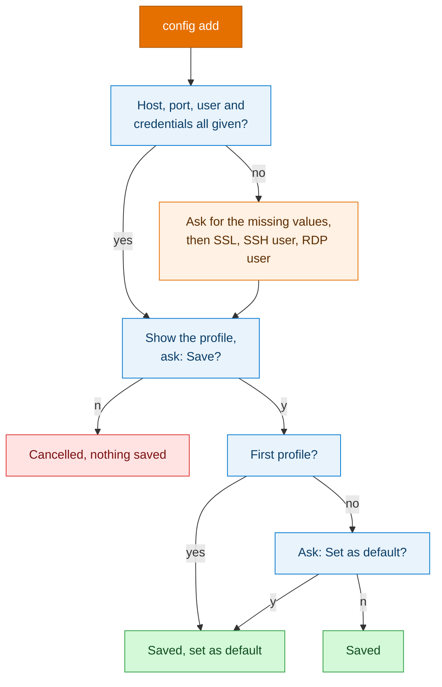
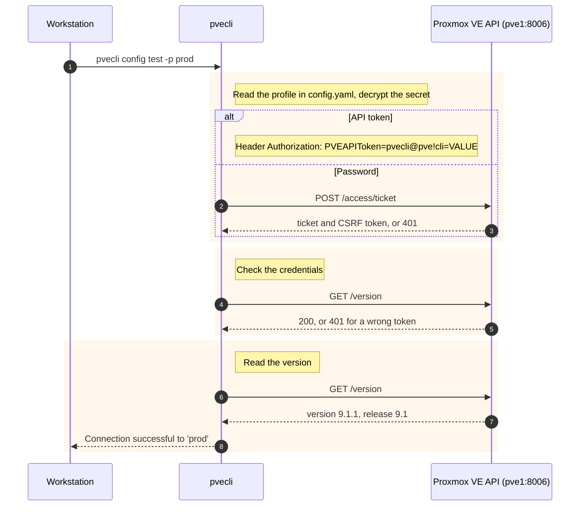

# Connect to a cluster

pvecli reaches a cluster through a profile: a name, the address of one node, and the credentials to use. You create the credentials on the cluster first, then the profile with [config add](../cli/config/add.md).

## Create an API token

An API token is the recommended way in. On any node of the cluster, as root, create a user for pvecli, give it a role, and create a token for it:

```bash
pveum user add pvecli@pve
pveum acl modify / --users pvecli@pve --roles Administrator
pveum user token add pvecli@pve cli --privsep 0
```

The last command prints the token value once, in the `value` row: copy it now. The token ID is `pvecli@pve!cli`; pvecli asks for its two halves separately, the user `pvecli@pve` and the token name `cli`.

In the web interface, the same token is under **Datacenter > Permissions > API Tokens > Add**, with **Privilege Separation** unticked so the token has the permissions of its user.

The Administrator role on `/` lets every pvecli command work. To give the token less, see [Permissions](../reference/permissions.md).

## Or use a password

A profile can also log in with a user and its password, for example `root@pam`. pvecli then asks Proxmox VE for a ticket at each run. [node vnc](../cli/node/vnc.md), the shell of a node in the browser, refuses token profiles: it needs a password profile.

The token value and the password are stored encrypted in the configuration file, with a key kept in `~/.config/pvecli/.age-identity`.

## Create the profile

Run `pvecli config add` and answer the prompts. Pick **API Token** in the menu (move with the arrow keys, ++enter++ to pick), or **Password** to be asked for one:

<div class="cast" data-src="../../assets/casts/start-config-add.cast" data-poster="npt:0:9" data-rows="30"></div>

- **Proxmox host**: the address or name of any node of the cluster.
- **Verify SSL certificate**: see [TLS verification](#tls-verification) below.
- **Default SSH user**: the account the `ssh` commands log in with, on guests and nodes.
- **Default RDP user**: the account `vm rdp` gives the RDP client (`Administrator` unless you change it). `vm rdp --user` overrides it.

The same profile in one line, for a script. Give the port too, or pvecli asks for it and the other settings. It still shows the profile and asks before saving it:

```bash
pvecli config add prod -ho 10.0.0.11 -po 8006 -us pvecli@pve -tn cli -tv 8c4f2a1e-6b3d-4e7a-9f15-2d8c7b6a3e41
```

What `config add` asks, and when the profile becomes the default. A name already in use stops it at once, with an error that points to `config edit`.



The profiles live in `~/.config/pvecli/config.yaml`. Every field, including the ones `config add` does not ask for, is described in [Configuration file](../reference/config-file.md). To change a profile later, use [config edit](../cli/config/edit.md).

## TLS verification

Proxmox VE nodes serve a certificate signed by the cluster's own certificate authority, which your machine does not trust. Leave verification off for them (the default). Turn it on, with `--verify-ssl` or by answering `y`, when the nodes carry a certificate from a public authority, for example one issued through ACME in Proxmox VE.

With verification on and the default certificate, pvecli cannot connect. `config test` shows why:

```text
Error: Connection failed: Connection failed to https://10.0.0.11:8006/api2/json: [SSL: CERTIFICATE_VERIFY_FAILED] certificate verify failed: unable to get local issuer certificate (_ssl.c:1130)
```

## Test the profile

[config test](../cli/config/test.md) logs in and reads the version of Proxmox VE:

--8<-- "screens/start-config-test.html"

What it asks the API:



A wrong token (first line) or password (second line) ends with exit code 1:

```text
Error: Connection failed: Authentication invalid or expired
Error: Connection failed: Invalid username or password
```

## Choose the default profile

The first profile you add becomes the default: commands run against it when you leave out `-p`. When you add another one, `config add` asks whether to make it the default. To change it later, use [config default](../cli/config/default.md):

--8<-- "screens/start-config-default.html"

The examples in this documentation always name the profile with `-p`. To run a command on several profiles or a group at once, see [Run a command on several clusters](../fleet/several-clusters.md).

## Open the web interface

[config login](../cli/config/login.md) opens the login page of the profile's node in your browser:

```bash
pvecli config login -p prod
```
