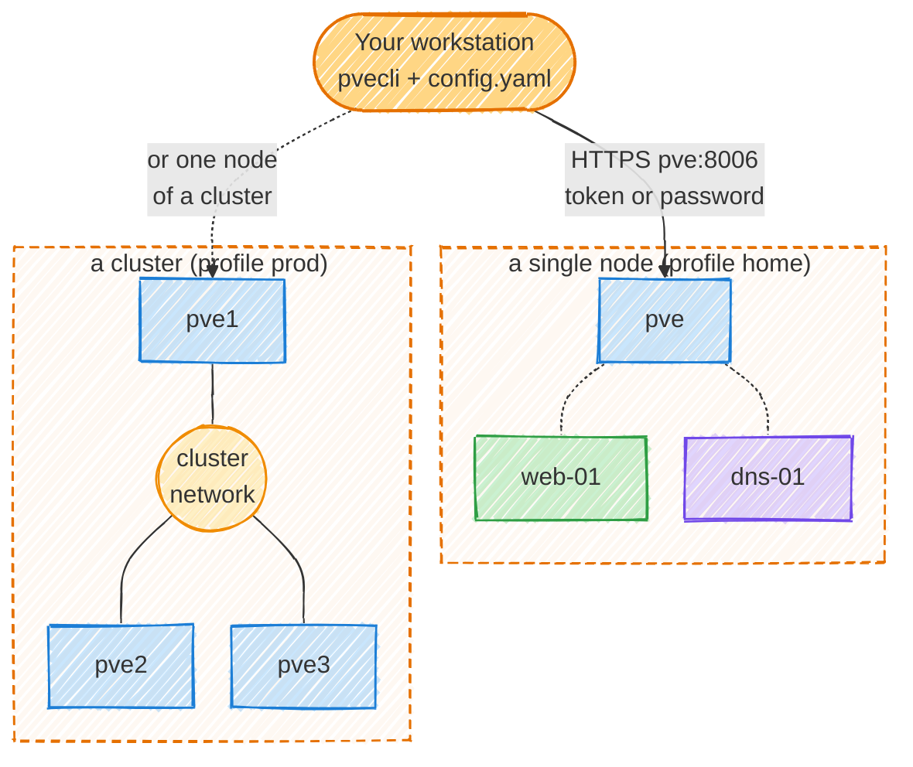

# Getting started

pvecli runs on your workstation with Python 3.10 or later and talks to the API of Proxmox VE 8 or 9: a single node, or a cluster. Nothing is installed on the nodes. You need an API token, or a user and password.

pvecli sends its API requests to the node of the profile. On a single node, that is all there is. In a cluster, that node answers for all of them: every node, VM and container.

Follow these pages in order:

-   :lucide-download:{ .lg } __Install pvecli__

    ---

    Install with pipx or pip, check the version, turn on shell completion.

    [:lucide-arrow-right: Install pvecli](install.md)

-   :lucide-key-round:{ .lg } __Connect to Proxmox VE__

    ---

    Create an API token, save it in a profile, test it.

    [:lucide-arrow-right: Connect to Proxmox VE](connect.md)

-   :lucide-square-terminal:{ .lg } __First commands__

    ---

    Look at the cluster, its nodes and guests, one guest in detail.

    [:lucide-arrow-right: First commands](first-commands.md)

[Install pvecli](install.md){ .md-button .md-button--primary }

Reference: [configuration file](../reference/config-file.md), [permissions](../reference/permissions.md), [all commands](../cli/index.md), [config](../cli/config/index.md).
