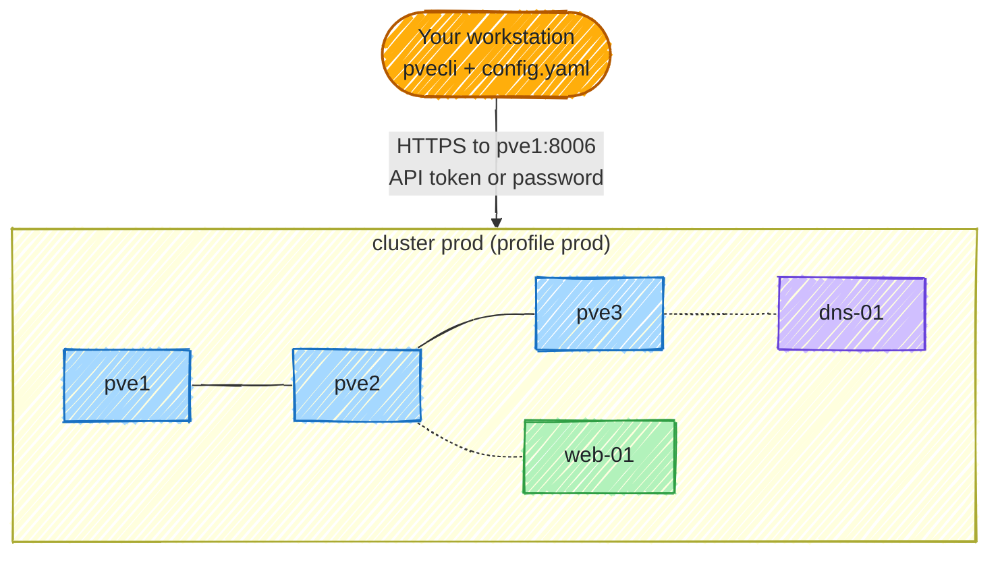

# Getting started

pvecli runs on your workstation with Python 3.10 or later and talks to the API of a Proxmox VE 8 or 9 cluster. Nothing is installed on the nodes. You need an API token on the cluster, or a user and password.

pvecli sends its API requests to one node, the one of the profile. That node answers for the whole cluster: every node, VM and container.

Follow these pages in order:

-   :lucide-download:{ .lg } __Install pvecli__

    ---

    Install with pipx or pip, check the version, turn on shell completion.

    [:lucide-arrow-right: Install pvecli](install.md)

-   :lucide-key-round:{ .lg } __Connect to a cluster__

    ---

    Create an API token, save it in a profile, test it.

    [:lucide-arrow-right: Connect to a cluster](connect.md)

-   :lucide-square-terminal:{ .lg } __First commands__

    ---

    Look at the cluster, its nodes and guests, one guest in detail.

    [:lucide-arrow-right: First commands](first-commands.md)

[Install pvecli](install.md){ .md-button .md-button--primary }

Command reference: [config](../cli/config/index.md).
